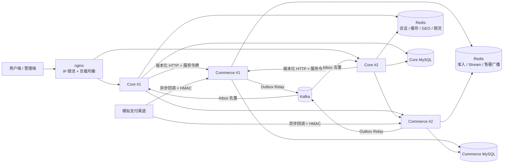
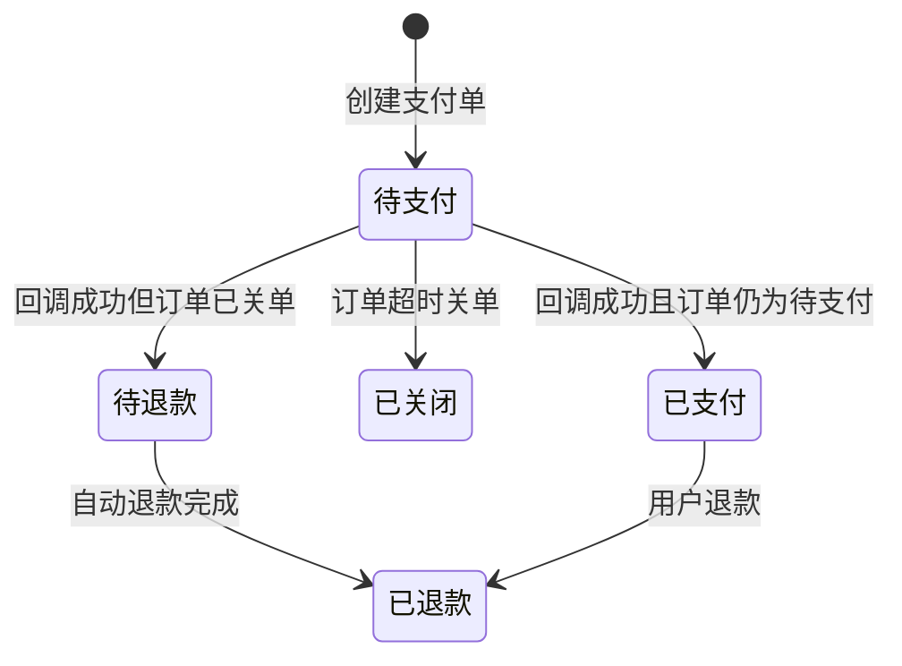
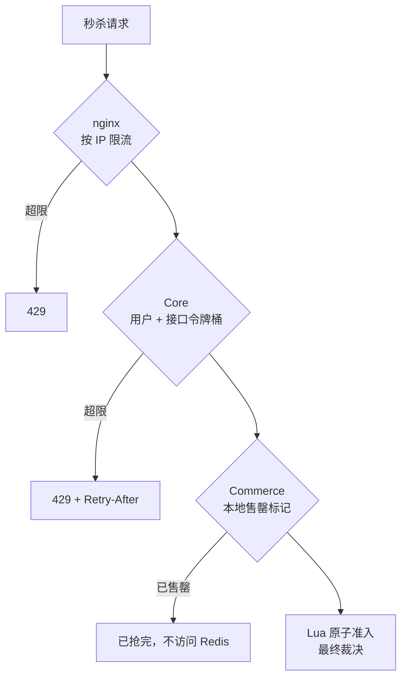
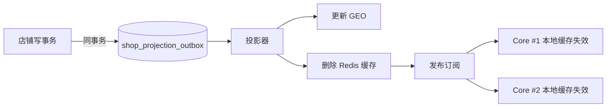

# CityCopilot 后端架构重规划（2026-10）

状态：P0、P1 六步已实现，相关集成、浏览器、压测和故障验证结果统一记录在 [E6](../evidence/2026-07-26-e6-performance-and-recovery.md)。售罄快速拒绝已改为不写账本、不分配订单号，售罄洪峰对照见 E6；本轮短压也未达到第 2 节的容量目标。P2 按第 6 节的实测触发条件决定，不预先实现。

## 结论

项目定位是单机部署的高并发本地生活交易后端，只有 Core 和 Commerce 两个服务。规划的原则是往深做、不往宽铺：围绕秒杀、支付、缓存、多实例四个最难的场景，把正确性、取舍理由和实测证据做透。不按「将来可能需要」增加组件。

优先级：
- P0：超时关单、模拟支付与回调竞态、分层限流、多实例验证；
- P1：两级缓存加 Outbox 驱动失效，在新代码上压测和故障演练；
- P2：库存分桶、Feed 推拉结合、订单分库分表、全链路追踪。P2 只有在压测数据证明需要时才实现，否则只写设计。

## 1. 现状

### 已经扎实的部分

| 领域 | 现有实现 |
|---|---|
| 秒杀准入 | 单个 Lua 脚本原子校验活动窗口、库存、一人一单和幂等键，同时预扣库存并写入 Stream |
| 异步落单 | Redis Stream 消费组；订单、恢复记录和 Outbox 同一个 MySQL 事务提交；进程重启后认领未确认消息 |
| 幂等 | 准入账本持久化每次准入；结果不确定时，用同一个幂等键重试会返回同一个订单 |
| 可靠消息 | 事务 Outbox 加抢占和 fencing，发布到 Kafka（3 节点）；消费端用 Inbox 去重；死信可查询、可幂等重放 |
| 一致性对账 | 定时比对 MySQL 和 Redis 库存，发现偏差先封住新准入，再由管理员带证据哈希修复 |
| 预约 | MySQL 条件更新、统一锁序、幂等命令；暂留到期由扫表任务释放 |
| 订单号 | MySQL 号段分配 |
| 店铺缓存 | Caffeine + Redis；互斥重建、空值缓存、TTL 随机抖动，投影 Outbox 驱动失效 |
| GEO | 同事务 Outbox 驱动的版本化投影，带租约的代际重建 |

### 本轮实现

1. 未支付订单按 `pay_deadline` 扫表关闭，库存恢复后允许取消用户重新下单。
2. 模拟支付保存支付单与回调结果，HMAC 验签、回调幂等、关单竞态、退款和支付对账共用 Commerce 事务边界。
3. 秒杀入口依次执行 nginx IP 限流、Core 用户令牌桶与 Commerce 售罄短缓存。
4. 独立 Compose 配置运行两个 Core、两个 Commerce；周期性写任务使用租约 fencing 或行锁分摊。
5. 店铺本地缓存通过既有投影 Outbox 失效；Commerce 券列表使用 Redis 版本化缓存。
6. Feed 保持 SQL 拉取；只有查询成为实测瓶颈才进入 P2。

## 2. 容量目标

单机 Docker 环境，以下是设计目标，最终以压测实测为准。

| 场景 | 目标 | 关键约束 |
|---|---|---|
| 秒杀入口 | 峰值 1 万 QPS，库存 1000 | 不超卖、不重复、可恢复；成功请求 P99 < 100 ms，返回 202 |
| 店铺详情、券列表 | 读 5000 QPS，热点店铺占 80% | 可以短暂读到旧数据，下单时权威校验 |
| 预约 | 单时段百级并发抢名额 | 不超订，改期原子完成 |
| 支付回调 | 至少一次送达、可能乱序和重复 | 幂等，和关单互斥 |

## 3. 目标架构

各层职责：
- **nginx**：按 IP 限流，挡脚本流量；把请求负载均衡到多个 Core。
- **Core**：身份认证、权限、用户维度限流、店铺和社区读写、对外 API。交易请求一律转发给 Commerce；Commerce 不可用时直接失败，不回退本地写入。
- **Commerce**：券、订单、秒杀、预约和支付的唯一写入方，负责异步落单、关单、对账和 Outbox。
- **Kafka**（2026-10-15 起替代 RocketMQ，见 ADR-0012）：只承载跨服务领域事件。Redis Stream 只承载 Commerce 内部的订单命令。

## 4. P0 设计

### 4.1 订单超时关单

**选型**：用带索引的扫表关单，不用 MQ 延时消息（Kafka 也没有原生延时消息）。

理由：
- 延时消息可能丢失，最终仍需扫表兜底，所以扫表才是事实来源；两套机制并存只会多一个出错点。
- 预约的暂留到期已经采用扫表模式（`BookingWorkers`），订单沿用同一套，概念统一。

机制：
1. 订单新增 `pay_deadline` 字段和索引 `(status, pay_deadline)`。
2. 定时任务用 `FOR UPDATE SKIP LOCKED` 小批量领取已到期的待支付订单。多个实例天然不会领到同一行。
3. 关单使用条件更新：`UPDATE ... SET status=已取消 WHERE id=? AND status=待支付`，影响行数为 0 说明已被支付或已被关闭，直接跳过。
4. 同一事务内写入库存回补记录和 Outbox；Redis 库存和买家集合沿用现有取消流程里的「恢复库存」阶段。

改动点：Commerce 迁移 V11、关单任务、订单状态补「超时取消」原因码。

测试点（加到 `SeckillLifecycleIT`）：
- 到期自动关单，MySQL 和 Redis 库存都回补；
- 关单和支付回调并发时，只有一个成功；
- 关单后同一用户可以重新下单。

### 4.2 模拟支付与回调

**选型**：不新建服务，在 Commerce 内实现一个模拟支付渠道：下单后创建支付单，模拟器异步回调 Commerce。

机制：
- 新表 `commerce_payment`：支付单号唯一、渠道流水号唯一，记录订单号、金额和状态。
- **回调幂等**：按渠道流水号去重，重复回调直接返回第一次的处理结果。
- **验签**：模拟渠道用 HMAC 签名，验签失败直接拒绝，不写任何数据。
- **关单和回调的竞态**（核心考点）：两边都对同一行订单做条件更新，以影响行数作为裁决，不用分布式锁。
  - 回调先到：订单变成已支付，随后的关单条件更新影响 0 行，放弃关单；
  - 关单先到：回调的条件更新影响 0 行，支付单标记为待退款，走自动退款，不复活订单。
- **对账**：每天比对支付单和订单状态，不一致的进入人工处理，复用现有的管理员修复入口模式。

改动点：迁移、支付服务、回调接口、前端支付按钮改为「发起支付，等待回调」。

测试点：重复回调、乱序回调、回调与关单并发、验签失败。

### 4.3 分层限流和售罄快速失败

**选型**：在 Core 入口用 Redis + Lua 实现令牌桶，不引入 Sentinel 或独立网关。Core 本身就是统一入口。

关键设计：
- 售罄标记是 JVM 本地状态，可能失真：库存回补后必须清除，否则会误拒。清除通知通过 Redis 发布订阅广播到所有实例。最坏情况是短暂误拒，永远不会超卖，因为最终裁决始终是 Lua。
- 命中售罄标记时只按幂等键查一次已有账本（同键已接受的请求仍返回原订单），不写账本、不分配订单号，售罄洪峰不会转成 MySQL 写入。
- 被限流返回 429 和 `Retry-After`，前端按提示退避。

测试点：
- 对比正常售罄标记与每次请求前广播失效，统计每请求 Redis Lua 次数；不新增生产开关，也不把串行对照吞吐当作容量；
- 库存回补后标记能被清除；
- 令牌桶的限流准确性。

### 4.4 多实例部署验证

这一项不增加组件，只证明现有设计在多实例下成立。

机制：
- 新增一份压测用的部署配置：2 个 Core、2 个 Commerce，前面用 nginx 负载均衡。日常开发仍保持单实例。
- Commerce 对账任务改用带 fencing 的租约选主（Core 的 `ShopProjectionLeaseService` 已有这个模式），去掉「只能单实例」的限制。
- 逐个梳理 `@Scheduled` 写任务：使用租约选主、`SKIP LOCKED` 分摊或已有的条件 claim；只读指标采样由各实例独立执行。

故障注入（各做一次并记录结果）：

| 注入 | 预期 |
|---|---|
| 秒杀压测中途 kill 一个 Commerce | Stream 未确认消息被另一实例认领，订单数等于准入数 |
| Outbox 发布中途 kill | 消息不丢；消费端靠 Inbox 去重，副作用不重复 |
| Redis 重启 | 准入失败关闭；对账修复后恢复 |
| 关单任务在两个实例同时运行 | 同一订单只被关一次 |

## 5. P1 设计

### 5.1 缓存体系

- **两级缓存**：本地 Caffeine 加 Redis。本地缓存 TTL 5 秒、限制容量，只扛热点店铺；Redis 层保留现有的互斥重建、空值缓存和 TTL 抖动。
- **失效机制**：用现有的店铺投影 Outbox 取代「写库后删缓存」。投影器在更新 GEO 的同一步删除 Redis 缓存，再通过发布订阅通知各实例清理本地缓存。删除失败会随 Outbox 重试，有序且不丢。
- **对比方案**：订阅 binlog（Canal）更通用，但要多一个组件；已有的同事务 Outbox 能达到同样效果。
- **券列表**：由 Commerce 缓存在自己的 Redis 里，券更新时按版本号失效；Core 侧不缓存交易数据。
- **不做布隆过滤器**：店铺 ID 是连续的，空值缓存已经能防止穿透。

测试点：店铺更新后各实例本地缓存在 1 秒内失效；热点店铺压测下 Redis QPS 的降幅。

### 5.2 压测和故障演练

- 在新代码上重跑秒杀、店铺详情、预约三组压测，记录 QPS、P99、Redis 和 MySQL 的 CPU 占用。
- 结果更新到现有的 E6 证据文档，这是简历上所有数字的唯一来源。
- 某个环节被证明是瓶颈时，才启动 P2 里对应的优化。

## 6. P2（由压测数据触发）

| 项目 | 触发条件 | 设计要点 |
|---|---|---|
| 库存分桶 | 单个库存键使 Redis 单核打满 | 库存拆成 N 个分桶，按用户哈希落桶；某个桶空了就从其他桶借 |
| Feed 推拉结合 | 关注流查询成为慢查询 | 普通作者发帖写入粉丝的 Redis 收件箱；大 V 的帖子由粉丝读取时拉取，再合并 |
| 订单分库分表 | 单表行数或写入量越界 | 订单号嵌入用户 ID 的基因位，按订单号和按用户查都能路由到同一分片；现在不分片 |
| 全链路追踪 | 跨服务问题难以定位 | 先基于已传递的 correlationId 把日志串起来，再考虑 OpenTelemetry |

## 7. 分布式事务选型

| 流程 | 方案 | 理由 |
|---|---|---|
| 秒杀下单 | MySQL 准入账本 → Redis 预扣与 Stream → MySQL 落单事务，最终一致 + 对账 | 准入账本同步持久化请求身份，订单落库异步执行 |
| 预约 + 优惠券 + 报价 | Commerce 单库本地事务 | 同一个服务、同一个库，不需要分布式事务 |
| 订单状态变化通知 Core | Outbox + Kafka + Inbox；Core 据此维护店铺销量（ADR-0012） | 跨服务只要求最终一致 |
| 支付回调与订单 | 状态机 + 条件更新 + 幂等 | 用同一行数据裁决竞态，不用分布式锁 |
| 不采用 | Seata AT、XA | 交易已经集中在 Commerce 单库，引入全局事务只增加锁竞争和运维成本 |

## 8. 并发控制一览

| 场景 | 手段 |
|---|---|
| 秒杀库存 | Lua 原子脚本，单线程执行保证原子性 |
| 预约名额 | MySQL 条件更新 + 统一锁序，避免死锁 |
| 优惠券领取 | 唯一键约束 + 幂等键 |
| 点赞、关注 | 唯一键约束，计数从事实表重算 |
| 订单状态流转 | 条件更新加版本号，本质是乐观锁 |
| 缓存重建 | Redis 互斥锁加 token，防止误删别人的锁 |
| 定时任务 | 租约加 fencing，或 `SKIP LOCKED` 分摊 |

## 9. 明确不做

- Spring Cloud、Nacos：只有两个服务，直接用 Docker DNS，不需要注册中心。
- Seata、XA：理由见第 7 节。
- 把 Elasticsearch 加回来、拆出更多微服务、为假想的生产规模预先实现能力。

## 10. 实施顺序

| 步骤 | 内容 | 实现位置 | 依赖 |
|---|---|---|---|
| 1 | 超时关单 | V11、`CommerceOrderService`、Stream Worker | 无 |
| 2 | 模拟支付与回调 | V12、`CommercePaymentService`、回调/管理接口、订单页 | 步骤 1 |
| 3 | 分层限流 + 售罄标记 | nginx、`UserRateLimitInterceptor`、`CommerceReadCache` | 无 |
| 4 | 多实例部署 + 任务选主 | 隔离 Compose、V13、`CommerceJobLease`、各后台任务 | 无 |
| 5 | 两级缓存 + Outbox 驱动失效 | `CacheClient`、店铺投影器、`CommerceReadCache` | 无 |
| 6 | 压测和故障演练 | `run_redesign_load.py`、`run_multiinstance_acceptance.py`、[E6](../evidence/2026-07-26-e6-performance-and-recovery.md) | 前 5 步 |

每一步完成时都要编译通过、相关测试和集成测试通过，并在真实环境验证一次，再进入下一步。

## 11. 实施边界

- 支付使用 Commerce 内的模拟渠道，没有外部支付机构接入。
- 默认部署保持单实例，双实例仅使用独立压测配置与隔离数据卷。
- V11 保存支付截止时间并调整取消后的唯一约束；V12 保存支付事实；V13 保存调度任务租约。旧数据升级要求见[数据库迁移说明](../database-migrations.md)。
- Feed 推拉、库存分桶、分库分表和全链路追踪保留第 6 节的设计与触发条件。
