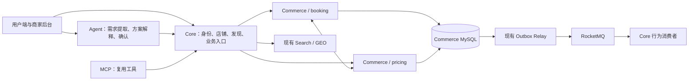
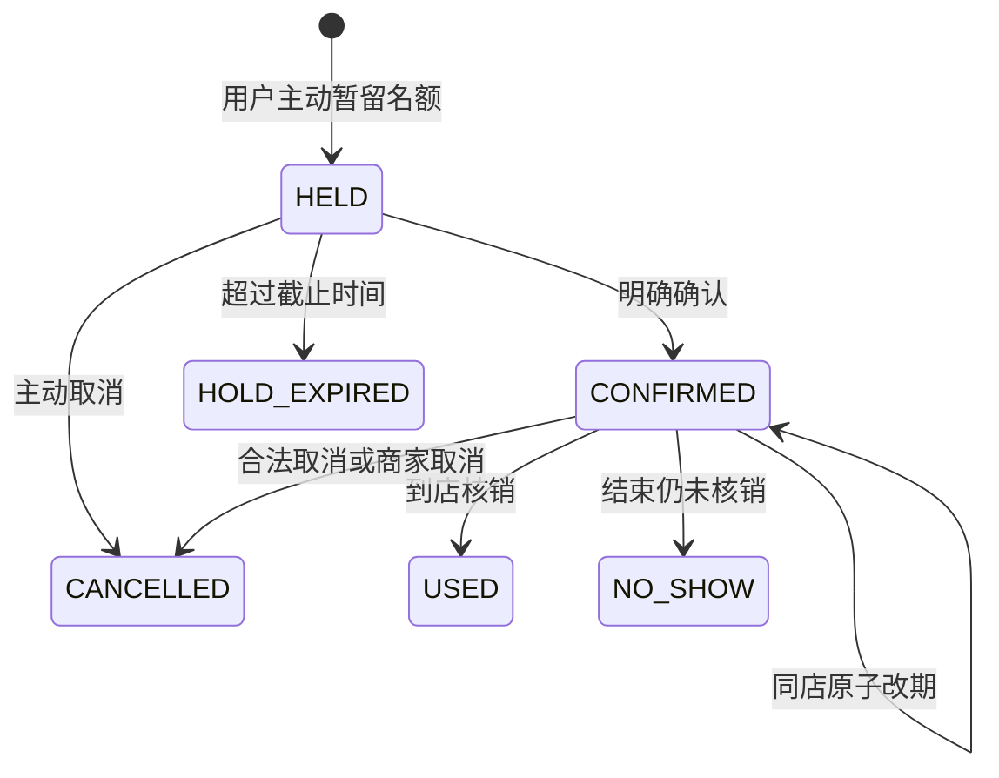

# CityCopilot 预约、优惠报价与消费方案实施计划

本文是功能与技术演进的执行依据。目标是形成可以由真实商家维护、真实用户完成预约的产品，并积累可核查的后端项目成果。勾选任务表示对应实现与本地验收已完成，具体范围以[交付证据](../evidence/booking-delivery-evidence.md)为准，不代表生产部署或真实商户试用。

> 2026-10-06：Agent、MCP、评测模块与 Elasticsearch 检索已从项目移除，本文中与 Agent 消费方案、确认卡片、行为反馈、批量方案查询和 ES 召回相关的内容仅作历史记录，对应代码已不存在。

范围已确定为运动场馆和餐厅；美容门店暂缓。先交付预约与报价，再接入 Agent 消费方案，个性化推荐作为后续里程碑。实施顺序见第 9 节；默认业务参数只在第 3 节维护。

阅读顺序：第 1～3 节确定产品和技术边界，第 4～8 节约定数据与业务契约，第 9 节直接用于任务执行，第 10～12 节用于验收、迁移和简历证据。HOLD 表示临时占位机制，数据库和 API 中的对应状态统一命名为 HELD。

## 1. 交付目标与范围

### 1.1 两条完整用户路径

| 场景 | 用户路径 | 商家需要维护的内容 |
|---|---|---|
| 运动场馆 | 找场馆 → 选择具体场地和时段 → 比较价格与优惠 → 暂留名额 → 确认预约 → 改期或取消 → 到店核销 | 场地、排期、时段开放状态、场地报价、预约优惠 |
| 餐厅 | 找餐厅 → 选择餐次和人数 → 选择可选的按人套餐 → 比较优惠 → 暂留名额 → 确认预约 → 到店核销 | 餐次接待名额、最大接待人数、套餐、预约优惠 |

餐厅首版管理“餐次接待名额”，不分配具体餐桌，不承诺拼桌或连桌。没有套餐的餐厅也可以提供订位，但页面只展示“消费金额到店确定”，不得将店铺人均价当作最终报价。

线上预约不收费，实际消费线下结算。预约核销表示商家确认履约，不表示支付渠道已经到账；取消也不生成“退款到账”状态。固定套餐和场地价必须由商家发布并承诺执行。

### 1.2 首版边界

- 一次预约只包含同一店铺的一项资源、一个时段；场馆占用一个场地，餐厅占用与人数相等的接待名额。
- 场馆使用固定长度时间槽；餐厅由商家发布互不重叠的固定餐次，不支持任意起止时间预约。
- 允许同店原子改期；场馆可改到同店另一场地，餐厅可变更餐次与人数。目标不可用时保留原预约。
- 精确报价只覆盖一个场地时段，或一个按人套餐 SKU；套餐份数等于预约人数，不做购物车和任意菜品组合。
- 优惠只使用本计划新增的预约营销券；既有秒杀券及券订单继续执行原有业务，不与预约券混用。
- 商家端复用现有后台，不新建独立商家前端；商家只维护本店资源与预约。
- 首版提醒采用站内消息；外部短信、微信提醒、线上支付、押金、自动罚款和跨店组合交易不在范围内。

### 1.3 可展示的阶段成果

1. 预约：两种容量模型、并发占位、原子改期、过期释放、核销。
2. 报价：确定性优惠计算、版本化规则、券与名额的事务协同、可解释价格。
3. Agent：把自然语言约束转成真实可预约方案，复用同一报价与预约 API。
4. 推荐：在前三项产生行为数据后，建立归因、特征和排序评测。

## 2. 技术选型与模块边界

### 2.1 选型决策

| 领域 | 本次采用 | 选择依据与边界 |
|---|---|---|
| 应用框架 | 复用 Spring Boot、现有 JDBC/事务和 Maven 模块 | 本轮不把框架升级与业务开发绑成一个大变更 |
| 预约库存 | MySQL InnoDB 条件更新、短事务、固定锁顺序 | 新业务需要多时段、券与报价的一致提交，先不建立 Redis 预约库存镜像 |
| 请求幂等 | Commerce 内操作记录、唯一键和请求指纹 | 覆盖新建、确认、改期、取消、核销，并能在响应丢失后查询原操作 |
| 跨服务事件 | 复用 Transactional Outbox 与 RocketMQ | 预约事实与事件同事务；继续保留既有秒杀内部 Redis Stream，不将其扩展为通用工作流 |
| 到期处理 | 数据库截止时间与有索引的分批扫描 | 截止时间为事实源，调度延迟不改变业务是否已经过期 |
| 优惠计算 | Java 纯计算函数、整数金额、有限组合枚举 | 固定规则种类足以支撑首版，不引入 Drools 或脚本执行引擎 |
| 搜索 | 现有 Elasticsearch/GEO 召回，Commerce 批量校验时段和价格 | ES 提供候选，不持有实时可预约性和最终报价的权威事实 |
| Agent | 复用工具契约、Core 工具入口、确认卡片与 SSE | 新业务规则落在 Commerce，模型不计算金额、不决定库存 |
| 推荐后续 | MySQL 行为数据与聚合、Redis 特征缓存、Java 候选重排 | 先验证可解释排序，不引入 Kafka、Flink、ClickHouse 或新的向量库 |
| 并发技术实验 | 核心业务完成后单独评估 Java 21 虚拟线程 | 仅针对地图、模型等阻塞 I/O 聚合，保持并发配额；用同负载对照判断是否采用 |

虚拟线程解决的是大量等待型任务的线程成本，不能预先承诺单次请求更快；实验依据见 [Oracle 虚拟线程文档](https://docs.oracle.com/en/java/javase/21/core/virtual-threads.html)。

### 2.2 数据所有权



- Core：身份、商户店铺归属、店铺资料、搜索入口、浏览行为和推荐特征。
- Commerce：资源排期、预约、预约券、报价、核销和站内预约提醒的唯一写入方。
- Agent：不直接查询 Commerce 数据库，工具通过 Core 调用 Commerce。
- 新预约与报价在同一个 Commerce 数据库事务中协同，不拆成预约微服务和优惠微服务，不引入分布式事务。
- 使用 `Booking` 命名新业务。现有 `commerce_reservation` 表服务于秒杀准入，不作为到店预约表。

Commerce 内的 [BookingResourceService](../../backend/commerce-service/src/main/java/com/citycopilot/commerce/booking/BookingResourceService.java) 负责资源发布、排期维护与查询；[BookingService](../../backend/commerce-service/src/main/java/com/citycopilot/commerce/booking/BookingService.java) 负责预约生命周期。预约命令在同一事务内完成名额占用、报价与优惠券处理、幂等结果及 Outbox 写入；资源排期维护先锁资源再锁时段，不调用预约命令，预约命令的锁顺序与事务边界保持不变。

### 2.3 复用位置

| 工作 | 现有入口 | 新增方式 |
|---|---|---|
| Core → Commerce | [CommercePortClient](../../backend/core/src/main/java/com/citycopilot/core/commerce/CommercePortClient.java) | 增加类型明确的方法；新增 DTO 放 contracts，不重写全部旧 Map 接口 |
| 商户归属 | [PlaceAuthorityClient](../../backend/commerce-service/src/main/java/com/citycopilot/commerce/PlaceAuthorityClient.java) | 管理操作复用权威店铺校验，远程调用放在数据库锁外 |
| 消息发布 | [CommerceOutboxRelay](../../backend/commerce-service/src/main/java/com/citycopilot/commerce/CommerceOutboxRelay.java) | 复用 claim、fencing、重试；增加预约事件 tag，保留旧订单 tag 的语义 |
| 搜索条件 | [ShopSearchRequest](../../backend/search/src/main/java/com/citycopilot/search/ShopSearchRequest.java) | 增加业务查询适配，复用现有关键词与地理召回 |
| 工具协议 | [AgentTool](../../backend/contracts/src/main/java/com/citycopilot/contract/tool/AgentTool.java) | 注册少量预约/报价工具，共用普通 API 的服务方法 |
| 前端 | [路由](../../frontend/src/router/index.ts)、[API](../../frontend/src/api/citycopilot.ts) | 复用用户端和后台布局，增加预约页面及方案卡片 |
| 数据升级 | [数据库迁移运行手册](../database-migrations.md) | Commerce 版本化 SQL 覆盖空库和已有数据卷 |
| 验收 | [Commerce 压测脚本](../../tools/loadtest/run_jmeter_commerce.ps1)、[EvalRunner](../../backend/eval/src/main/java/com/citycopilot/eval/EvalRunner.java) | 复用工具，新增预约数据与不变量、结构化方案断言 |

现有一致性和搜索边界继续引用 [Commerce ADR](../adr/0009-commerce-high-concurrency-admission.md) 与 [搜索投影 ADR](../adr/0010-versioned-shop-search-geo-projections.md)。本计划不重复维护既有服务部署状态、依赖版本或历史测试成绩。

## 3. 首版业务参数与不变量

### 3.1 参数的唯一维护位置

下列值是实施默认值，业务试用后可以调整。时间参数应集中绑定在业务配置或商家排期规则中，页面从 API 获取实际生效值，不再次硬编码。

| 参数 | 首版值或规则 |
|---|---|
| 场馆时段 | 60 分钟，按场馆当地整点发布 |
| 餐厅餐次 | 商家指定起止时间，同一接待名额池内不重叠 |
| 可发布窗口 | 未来 14 天 |
| 场馆容量单位 | 一块具体场地每时段容量 1；预约 units=1 |
| 餐厅容量单位 | 商家设置接待人数上限；预约 units=partySize |
| 餐厅单笔人数 | 1～8 人，且不得超过该餐次容量 |
| 场馆参与人数 | 由资源发布的 maxPartySize 约束，不等于占用场地数量 |
| HOLD 有效期 | 120 秒，不自动续期 |
| 报价有效期 | 300 秒；创建 HOLD 时校验，成功后由 HOLD 截止时间约束确认 |
| 占位配额 | 每用户最多 1 个有效 HOLD；HOLD 与未来 CONFIRMED 合计最多 3 笔 |
| 普通取消和改期截止 | 仅约束 CONFIRMED，以原预约开始前 30 分钟为截止；HELD 可主动取消，目标新时段只允许在开始前进入 |
| 核销窗口 | 开始前 15 分钟至时段结束；结束后未核销转 NO_SHOW |
| 预约提醒 | 开始前 30 分钟；在提醒点之后确认的预约不补发已错过的提醒 |
| 优惠种类 | 满减、折扣、代金；最多使用 2 张不同种类、双方允许叠加的券 |
| 自动选券规模 | 同一用户、同店仍可能使用的 AVAILABLE + RESERVED 券合计最多 20 张；发券在用户 guard 内执行上限，不截取候选掩盖超限 |
| 币种与金额 | 首版 CNY；金额以整数分存储，折扣支付比例以万分比存储 |
| 默认商家时区 | Asia/Shanghai；数据存 UTC，接口使用带偏移的 ISO-8601 时间 |
| 预约到期扫描 | 每 5 秒按截止时间取最多 100 个候选，逐单短事务复核 |
| 站内提醒扫描 | 每 10 秒按提醒时间取最多 100 个候选，逐单检查预约当前状态与排期版本 |
| 反馈保留与特征窗口 | 浏览行为、候选曝光与近期特征窗口默认 30 天；业务事实随预约保留，不自动删除；负反馈保留至用户清除 |
| 派生特征缓存 | 默认 60 秒；Redis 只作可重建缓存，这是数据库特征更新后的缓存时效，不是 MQ 发布到消费的端到端时限 |
| 反馈清理扫描 | 默认每小时；实际生效的保留期、窗口与缓存时间由反馈规则 API 返回 |

### 3.2 必须成立的不变量

- 时段 `0 <= occupied <= capacity`；occupied 等于该时段仍占用资源的预约 units 之和。
- HELD、CONFIRMED、USED、NO_SHOW 占用对应排期事实；取消和 HOLD_EXPIRED 不占用。已结束的排期不可再售，不为了清零计数而抹去历史使用。
- 一个用户幂等键最多对应一次已提交操作，且只能绑定一个动作和请求指纹。
- 同一报价最多绑定一笔预约；同一张预约券最多绑定一笔有效预约。
- 改期失败时旧时段、旧报价、旧券、旧核销码和预约状态均保留。
- 核销、取消、过期释放每次至多产生一次业务效果；业务记录与 Outbox 同事务提交。
- 已确认预约的价格快照不可被后续调价覆盖；改期使用新报价，经用户确认后替换。
- 商家归属、金额、容量与确认均由服务端校验，模型和前端不提供权威值。

## 4. 数据模型与并发设计

### 4.1 预约阶段新增表

以下表名、字段为目标模型。使用现有 Commerce 数据源和事务机制；只建立单库外键，不建立指向 Core 用户或店铺库的跨库约束。

| 表 | 关键字段 | 约束与主要索引 |
|---|---|---|
| `commerce_booking_resource` | id、shop_id、kind、name、timezone、max_party_size、status、version | kind 为 COURT 或 DINING_POOL；status 为 OPEN、STOP_NEW、UNAVAILABLE；店铺归属创建后不可任意转移；索引 shop_id/status |
| `commerce_booking_slot` | id、resource_id、start_at、end_at、capacity、occupied、status、version | 唯一 resource_id/start_at；CHECK 容量边界和结束晚于开始；索引 resource_id/start_at/status |
| `commerce_booking` | id、user_id、shop_id、resource_id、slot_id、party_size、units、status、reason_code、hold_expires_at、version、schedule_version、price_snapshot、checkin_token_hash、source、impression_id、request_id、created_at | 索引 user_id/status/start_at、shop_id/start_at、status/hold_expires_at；写入预约时间快照供查询；归因字段可空 |
| `commerce_booking_user_guard` | user_id | 主键 user_id；只用于本用户配额与预约变更的事务串行化 |
| `commerce_booking_command` | actor_id、idempotency_key、action、request_hash、booking_id、result_json、created_at | 唯一 actor_id/idempotency_key；结果与业务变更同事务保存 |
| `commerce_booking_reminder` | booking_id、schedule_version、kind、due_at、status、delivered_at、read_at | 唯一 booking_id/schedule_version/kind；索引 status/due_at |

预约主键为不可预测的 UUID 字符串，避免给已有订单号段增加无业务收益的耦合。数据库自增 ID 可用于资源、时段等内部配置对象；对外长整型 ID 沿用字符串表示。

时间不重叠由排期发布事务保证：先锁定资源行，再检查拟发布区间与已有区间，统一使用半开区间 `[start_at,end_at)`。相邻餐次可以首尾相接。已有有效预约时不允许删除或修改时段时间；容量只能调整到不小于 occupied 的值。

### 4.2 报价阶段新增表

| 表 | 关键字段 | 约束与责任 |
|---|---|---|
| `commerce_booking_offer` | id、resource_id、shop_id、kind、title、unit_price_cents、version、status | kind 为 COURT_SLOT 或 PER_PERSON_PACKAGE；场馆每资源一个有效价目，餐厅可有多个套餐；调价递增 version |
| `commerce_booking_coupon_rule` | id、campaign_key、rule_version、shop_id、offer_scope、type、threshold_cents、reduction_cents、pay_factor_bps、discount_cap_cents、stackable、service_from/to、issuance_status | 唯一 campaign_key/rule_version；发布后经济规则不可修改，变更创建新版本；发行状态与经济规则分离 |
| `commerce_user_booking_coupon` | id、user_id、rule_id、status、expires_at、booking_id、revoked_at | 唯一 user_id/rule_id 用于首版每版本限领一张；索引 user_id/status；规则适用范围与个人券状态均参与校验 |
| `commerce_booking_quote` | id、user_id、purpose、booking_id、expected_booking_version、resource_id、slot_id、party_size、offer_id、offer_version、coupon_ids、breakdown_json、total_cents、expires_at、consumed_booking_id、request_hash、source、impression_id、request_id | purpose 为 CREATE 或 RESCHEDULE；条件更新消费；完整保存本次报价依据和明细；归因字段随预约持久化 |

餐厅纯订位的报价使用 `pricingMode=ON_SITE`，totalCents 为 null，不能参与“预算内套餐方案”的比较。有商品价格的报价使用 FIXED，totalCents 允许为 0；不得把 null 和 0 混用。

### 4.3 锁顺序与事务边界

所有预约变更通过同一组领域方法执行，统一遵循：

```text
预约所属用户 guard
→ 已存在的 booking（创建时没有）
→ 涉及的 resource / offer 元数据行，分别按 ID 排序
→ quote（需要报价时）
→ 涉及的 slot，按 ID 升序
→ 涉及的用户券，按 ID 升序
→ command / reminder / outbox 的写入
```

- 商家核销和取消同样先锁预约所属用户 guard，不改成锁商家用户；actor_id 只表示操作人。
- 新建在完成目标时段和券校验后插入 booking；不要在持有时段锁后再寻找并锁定另一笔已有预约。
- 排期管理只锁资源与时段，价目管理只锁对应元数据；批量商家取消先取 ID，再逐单进入公共锁序，禁止反向持锁遍历预约。
- 配额在用户 guard 内检查；不再增加另一组活跃预约生成列唯一键来重复维护配额。
- 远程商户归属校验、模型调用、MQ 发送均在本地事务之外。事务内通过资源关系、版本、截止时间和条件更新确认本地约束。
- 事务外拿到的查询结果仅用于定位；真正变更前必须在上述锁序下重读必要记录。
- 截止时间在取得锁后使用数据库 UTC 时钟判断，不能沿用排队前的应用时间。
- 固定锁序减少死锁，但不声明绝不会死锁。数据库死锁或锁超时使整笔操作回滚，返回可重试结果，客户端沿用同一幂等键；依据见 [MySQL 锁顺序与死锁处理说明](https://dev.mysql.com/doc/refman/8.4/en/innodb-deadlocks-handling.html)。

占用名额的核心操作是带容量条件的 UPDATE；释放也是条件状态迁移后的同事务 UPDATE。新增语句必须检查影响行数。餐厅按 units 增减，不能默认每单都只加减 1。

已提交的操作记录与业务变更同事务保存，包括成功结果和明确终态化的业务拒绝。同键、同指纹重试返回原操作结果及 bookingId；同键、不同指纹返回冲突。鉴权与基本请求形状校验后，先查已提交 command，再在取得用户 guard 后复查；命中时直接重放，不再校验已经变化的预约版本或截止时间。最终唯一键冲突需要整笔回滚后读取原记录并比对指纹，不能只返回数据库冲突。

未提交的失败不遗留 RUNNING 操作记录，允许同键重新尝试。网络结果未知时通过操作查询恢复，不能自动换键提交另一笔。

## 5. 预约、报价、优惠券的联合生命周期

### 5.1 预约状态机



浏览、搜索、试算不产生 HELD。普通页面和 Agent 都只有在用户选择“暂留名额”后才占用容量，并展示截止时间；最终确认卡片说明场馆、时段、人数、固定报价或到店结算说明。对已暂留方案的最终确认不再重复生成一个新的暂留动作。

纯预约阶段允许不带报价的 HELD；此时统一为 ON_SITE，已有历史预约以后也不自动转换成固定报价。报价功能启用后，提供固定价的资源创建 HELD 必须引用有效 quoteId。

### 5.2 创建 HELD

1. 校验身份和请求形状并检查幂等重放。该用户已过期 HELD 先通过独立短事务回收并提交，然后开启新占位事务；取得用户 guard 后再次检查幂等记录与配额，不把旧预约锁带进新目标事务。
2. 对固定报价，锁定对应元数据和报价，核对用户、资源、时段、人数、有效期、价目版本及请求指纹。
3. 按固定顺序锁时段与选券，使用同一计算器重算。价格或可用条件已变化时返回差异，不替用户接受新价格。
4. 事务内完成占用名额、预约券 AVAILABLE → RESERVED、保存预约及价格快照、报价绑定预约、保存 command、追加 Outbox。
5. hold_expires_at 不晚于业务 HOLD 上限、开始时间，以及所选个人券的有效截止时间；报价只决定是否允许进入该事务。
6. 事务提交后才向客户端返回 HELD。报价已消费后不能创建第二笔预约；原 HELD 过期后需重新报价。

短期暂留本身构成商家价格承诺：在 HOLD 有效期内，商家普通调价不追溯改变快照，确认也不因为原报价展示计时结束而失效。

### 5.3 确认、取消、核销与过期

- 确认：重新核对 HELD 状态、截止时间、资源接待状态和个人券资格。普通规则版本发布不影响已锁定快照；STOP_NEW 不影响已有 HELD 的确认，UNAVAILABLE 才表示无法接待。
- 确定性失效：明确撤券或无法接待时，在同一事务将 HELD 转为 CANCELLED，保存 reason_code、释放名额和已锁券、记录 command 与事件，提交后返回业务拒绝。同键重试返回已提交结果。超时对应 HOLD_EXPIRED；数据库或网络瞬时故障只回滚，不自动撤销原暂留。
- 普通取消：HELD 始终允许主动撤销；CONFIRMED 遵守第 3 节截止规则。商家临时无法接待时可取消本店未来预约，必须记录原因并生成站内通知。
- 取消和 HOLD_EXPIRED：名额与券同事务释放。券已超过有效期则转 EXPIRED，被撤销则转 REVOKED，否则回 AVAILABLE。
- 核销：商家提交预约号及核销凭证，验证归属、窗口和预约状态，同事务 CONFIRMED → USED、券 RESERVED → CONSUMED。客户端不携带“已付款”断言。
- NO_SHOW：保留历史名额占用，释放未消费券，依据截止与撤销情况决定券的最终状态；首版记录爽约，不自动罚款。
- 已确认预约正常持有的券即使跨过领取券的使用截止时间，也按确认快照保留到履约。紧急撤券不允许静默取消商家已经承诺的价格；需商家明确取消或履约处置。
- 过期任务先按索引读取候选 ID，再逐单走相同锁序；多实例重复执行只允许一次有效状态迁移。
- 查询响应依据数据库时间返回 expired 和 allowedActions；即使回收任务尚未更新持久状态，也不得继续向用户展示“可以确认”。
- 资源暂停发布只阻止新预约；“暂不接单”和“无法履约、取消已有预约”是两项不同管理动作。

### 5.4 原子改期

改期只针对 CONFIRMED，且限定同店。餐厅人数变化也属于改期；场馆资源变化必须仍属于同店。原预约必须尚未超过普通改期截止，目标时段必须尚未开始；二者分别按数据库时间判断。

1. 生成 purpose=RESCHEDULE 的新报价，绑定 bookingId 与 expectedBookingVersion。
2. 原预约 RESERVED 的券可作为候选；只能复用绑定本预约、符合新时段条件且重新报价时尚未过期或撤销的券，不能借用其他预约的券。原预约对已过期券的价格承诺不自动迁移到新排期；用户不接受新差价时，原预约与原价格不变。
3. 用户明确确认新时间、人数和价格差异。改期不提前占用目标时段，也不取消原预约。
4. 事务锁定预约、元数据、报价、旧新时段及旧新券集合；锁集合按第 4 节顺序排序。
5. 目标是不同槽时先验证并占用目标容量，再释放旧容量；同槽人数变化只调整 units 差额。
6. 条件不满足整笔回滚；条件满足则更新预约、价格快照、券绑定，递增 version 和 schedule_version，更换核销凭证，撤销旧提醒并登记新提醒，消费新报价、写 command 和 Outbox。

P2 纯预约阶段执行同样的原子时段变更，但使用 ON_SITE；P3 为它增加报价与券的事务步骤。不得用“取消旧预约后新建”代替原子改期。

### 5.5 提醒

提醒表同时作为预约站内消息的来源，由 Commerce 维护，Core 通过端口查询，不再建立第二份提醒事实表。

确认和改期在同一事务登记新 schedule_version 的提醒；取消和核销撤销待提醒。调度按索引取到期候选，锁预约后检查状态与 schedule_version，再标记可见。消息列表只返回仍与当前预约排期相匹配的有效提醒，已过时的提醒不继续显示为可执行事项。

长期预约的提醒依赖数据库 due_at。后续若将近期调度改成 RocketMQ 延时消息，也只把消息当唤醒信号，执行时仍查当前事实；默认延时范围和投递约束见 [RocketMQ 延时消息文档](https://rocketmq.apache.org/docs/featureBehavior/02delaymessage/)。

## 6. 确定性报价与券规则

### 6.1 基础价格

- 场馆：发布的场地时段价，人数不改变占用场地数量。
- 餐厅固定套餐：发布的按人单价 × 预约人数；明确包含项目与另收费项目。
- 餐厅纯订位：无固定总价，不能使用预约营销券抵扣一个尚不存在的商品金额。
- 不使用店铺 avgPrice、评论文字或模型估价生成应结算金额。
- 商家调价递增 offer.version；已发个人券引用不可变 rule 版本，新发布规则只影响新发券。
- 商家“停发券”与“撤销个人券资格”分开处理；停止发行不会让已领取的券自动失效。
- 发券在用户 guard 内计算 AVAILABLE 与 RESERVED 合计；过期或撤销的 AVAILABLE 券应先终态化。已锁定并仍可能释放回可用的券必须计入配额，不能靠暂留名额绕过持券上限。

### 6.2 算法与解释

1. 根据用户、店铺、商品、服务时间与券状态取完整适用候选集，受第 3 节发行上限约束。
2. 枚举不使用券、单券和合法双券组合；双券必须不同种类且双方允许叠加。
3. 固定计算顺序为“折扣 → 满减 → 代金”；满减门槛统一依据优惠前的适用商品金额。
4. 每步按整数分四舍五入，折扣使用整数万分比；计算中检查乘法范围，不使用 double 表示金额。
5. 单步减免不超过剩余金额；有折扣封顶时明确保存实际减免。
6. 按最终金额、使用券数量、优先消耗较早到期券、券 ID 的稳定顺序选结果。
7. 返回每张券的适用依据、减免额、原价与最终金额；“最优”只指已定义规则下、本次完整候选集的最低金额。

手工黄金样例：原价 20000 分，9 折券与满 20000 减 3000 券可叠加，结果依次为 18000 分、15000 分；另一张 4000 分代金券与满减券可叠加时，结果为 13000 分，应选后者。该样例只用于校验算法，不作为商家实际优惠配置。

### 6.3 报价响应

目标 DTO 至少包含：

```json
{
  "quoteId": "uuid",
  "purpose": "CREATE",
  "pricingMode": "FIXED",
  "resourceId": "101",
  "slotId": "1001",
  "partySize": 2,
  "units": 2,
  "offerId": "501",
  "offerVersion": 3,
  "currency": "CNY",
  "baseCents": 20000,
  "discountLines": [],
  "totalCents": 20000,
  "expiresAt": "2026-10-01T11:05:00+08:00"
}
```

示例值不代表运行配置。创建 HELD 接收 quoteId 和幂等键，不接收客户端指定 totalCents；到店页面明确显示“按预约约定线下结算”。

## 7. API、页面与 Agent 契约

### 7.1 对外 API

以下为 Core 对外路径，前端经现有 /api 前缀访问；对应内部接口位于 Commerce /commerce/v1 下。新增成功、冲突、容量不足等 HTTP 状态由 Core 保留，不能把类型明确的新契约再次压缩成只剩 ID 的返回值。

| 方法与路径 | 作用 | 关键请求或约束 |
|---|---|---|
| GET /shops/{shopId}/booking-resources | 资源和可预约业务类型 | 返回 COURT / DINING_POOL 与实际规则 |
| GET /booking-resources/{id}/slots | 查询排期与余量 | dateFrom/dateTo；只接受有限时间窗口 |
| GET /booking-resources/{id}/offers | 查询场地价或套餐 | 无固定套餐时返回 ON_SITE 能力 |
| POST /booking-quotes | 创建报价 | resourceId、slotId、partySize、offerId、选券模式；改期附 bookingId/version |
| POST /bookings/holds | 主动暂留名额 | Idempotency-Key；固定价传 quoteId，纯订位传目标条件 |
| POST /bookings/{id}/confirm | 确认暂留 | Idempotency-Key、expectedVersion |
| POST /bookings/{id}/cancel | 取消本人预约 | Idempotency-Key、expectedVersion |
| POST /bookings/{id}/reschedule | 原子改期 | Idempotency-Key、新 quoteId、expectedVersion；纯订位使用明确目标条件 |
| GET /bookings、GET /bookings/{id} | 本人预约列表与详情 | 返回预约状态、截止时间、价格说明、允许动作 |
| GET /booking-commands/{key} | 查询当前 actor 的原操作结果 | 用于响应丢失恢复；不可按他人用户 ID 查询 |
| GET /booking-coupons、POST /booking-coupons/claims | 列表与领取预约券 | 领取请求幂等，校验适用范围及个人数量限制 |
| GET /booking-notices、POST /booking-notices/{id}/read | 站内提醒 | 当前用户范围 |
| POST /admin/shops/{shopId}/booking-resources | 商家维护资源 | 明确字段 DTO，继承店铺归属校验 |
| POST /admin/booking-resources/{id}/slots | 发布排期或受控调整 | 排期冲突、容量调整检查 |
| POST /admin/booking-resources/{id}/offers | 发布或更新价目/套餐 | 更新递增版本，保留历史预约快照 |
| POST /admin/shops/{shopId}/booking-coupon-rules | 发布预约券规则版本 | 发布后经济规则不可变 |
| GET /admin/shops/{shopId}/bookings | 本店预约工作台 | 时间、状态筛选 |
| POST /admin/bookings/{id}/check-in | 到店核销 | Idempotency-Key、凭证、expectedVersion |
| POST /admin/bookings/{id}/cancel | 商家无法接待取消 | Idempotency-Key、expectedVersion、原因 |

新增专用权限如 booking:manage、booking:check-in；消费者只能操作本人预约。身份和管理范围来自 Core 验证结果，不来自客户端提交的 admin 字段。规则停发、个人券撤销等管理动作在 P3 使用明确动作 DTO 补齐，不复用秒杀券核销入口。

错误码至少区分 BOOKING_SLOT_FULL、BOOKING_QUOTA_EXCEEDED、BOOKING_VERSION_CONFLICT、BOOKING_HOLD_EXPIRED、BOOKING_CUTOFF_PASSED、BOOKING_QUOTE_CHANGED、BOOKING_COUPON_UNAVAILABLE、BOOKING_IDEMPOTENCY_CONFLICT。错误响应带当前可操作状态和重试指引，不只返回“失败”。

### 7.2 页面交付

- 店铺详情增加预约区域；根据资源类型展示场地或餐次，展示名额、套餐和适用规则。
- 新增“我的预约”与详情页，和已有券订单分开展示，避免两种核销对象混淆。
- 选择方案后进入暂留确认卡片，倒计时来自 holdExpiresAt；超时从后端刷新状态，不只依赖浏览器倒计时。
- 改期页面并排展示旧新时间、人数、价格和券变化；失败继续展示旧预约。
- 商家后台增加资源排期、套餐、券规则、预约列表和核销面板；日历采用现有组件或原生日期输入。
- 站内提醒链接至预约当前详情，不在消息里生成可直接绕过状态校验的写入口。

### 7.3 Agent 消费方案

先支持两个固定任务：

- “周六晚上，两个人，附近有没有 200 元以内的羽毛球场？”
- “今晚四个人，人均 100 元以内，附近有能预约的餐厅套餐吗？”

结构化需求包括场景、日期、时段、人数、地理范围、预算口径（总额/人均）与显式偏好。缺日期、时段、人数或预算含义时先澄清。店铺仅有直线距离时不声称“步行 15 分钟”；步行时间约束需要实际路线服务数据，否则明确尚未验证。

业务链固定为：

```text
解析和澄清硬约束
→ Core 获取本地可预约候选
→ Commerce 批量查询时段和固定价方案
→ 同一报价计算器筛选预算内方案
→ 展示包含真实资源、时段、人数、金额的卡片
→ 用户选择暂留
→ 用户最终确认
→ 查询预约结果
```

不将实时库存写进 ES 当作下单依据，也不为每个搜索结果逐个调用 Commerce；新增批量候选能力并限定每轮候选规模。没有符合条件的方案时说明约束，不以外部 POI 或模型编造的价目补齐。

工具控制在 search_bookable_options、list_booking_slots、quote_booking、hold_booking、confirm_booking、reschedule_booking、cancel_booking、get_my_bookings；商家核销先只开放后台，不交给普通对话。

所有占位、确认、改期和取消都通过确定性写操作入口。批准记录绑定当前用户、动作、quote/booking ID、目标参数、价格摘要及有效期；ReAct 与 Plan-Execute 必须遵守同一约束，不能仅靠关键词分流。复用现有确认 UI 和目录，按新操作契约补充稳定 operationId 与结果查询，不搭新的通用工作流引擎。

## 8. 事件与后续行为推荐

### 8.1 预约事件

新增 BookingChangedEvent，信封包含 eventId、eventType、schemaVersion、aggregateType、aggregateId、aggregateVersion、occurredAt、correlationId。载荷包含 bookingId、shopId、userId、状态、scheduleVersion、排期与人数快照、quoteId 和价格模式。

aggregateVersion 使用预约递增 version，从 0 开始，不能使用状态码；改期虽保持 CONFIRMED，也必须产生新版本。scheduleVersion 的初始值同样允许为 0，不能把合法的新建事件当成无效消息。核销凭证、手机号不进入事件载荷。

只从现有订单私有 Outbox 写入逻辑提取必要的共用方法，不重建事件总线。Relay 增加明确的 BookingEvent tag；既有订单和 discrepancy tag、消费组行为保持兼容。发布至少一次，消费者按 eventId 去重。

### 8.2 推荐的启动条件与数据归属

P1～P4 只在新流程携带 requestId、impressionId、quoteId、bookingId 等可选归因字段；source、impressionId 和原始 requestId 随报价、预约持久化，并出现在相应领域事件中，不提前建设完整埋点平台。P6 在预约与报价已完成验收后实施，不阻塞核心发布。

P6 的曝光由服务端生成并绑定用户、候选及排序版本；后续请求只能引用该记录，不能自报曝光位置或冒用他人曝光。来源字段不参与金额与权限判断。历史没有有效曝光记录的预约不回填成已归因转化；只有验证归因有效后才进入转化统计。

Core 新增浏览行为入口与独立的预约业务事件消费者：

- 服务端曝光记录表示实际返回的候选集合；用户是否看过另以 VIEW 记录。客户端只报告 VIEW、CLICK、FAVORITE、NOT_INTERESTED，userId、候选位置和来源必须服务端关联验证。
- 预约确认、取消、核销由 Commerce Outbox 产生，不信任前端自报成交或履约。
- Inbox 登记与行为落库在同一个消费者事务中完成，再 ACK；不能在现有 Inbox 方法提交后另起事务写业务。
- 预约当前状态投影按 aggregateVersion 防旧覆盖；累计行为按 eventId 完整入账，不能把晚到的真实事件仅因版本较低丢掉。

P6 数据模型为 search_impression、user_behavior_event、user_preference_feature 和 booking_behavior_projection。原始行为只保存排序所需字段，保留期和特征窗口见第 3 节。没有历史特征的候选批量返回零值，不逐店重建；过期窗口可从 MySQL 事实重算。

### 8.3 第一版排序

Elasticsearch/GEO 召回候选 → Commerce 批量过滤真实时段、人数和预算 → Java 融合相关性、距离、显式偏好、近期履约质量 → 输出确定排序和原因。

无行为的新用户使用显式偏好、距离与公共质量；没有真实行为时不模拟“猜你喜欢”。负反馈优先影响未来排序，并提供清除入口。Redis 只缓存可重建特征。

先做可解释规则重排，记录 rankingVersion，比较固定候选集下的 NDCG@10、硬约束满足率和延迟。有足够真实曝光后再比较有效点击和预约/履约转化；不将合成数据写成线上 CTR 提升。只有语义召回不足被标注集证明时，才在现有 ES 评估向量召回，能力边界参考 [Elasticsearch kNN 文档](https://www.elastic.co/docs/solutions/search/vector/knn)。

## 9. 分阶段实施任务

估算按一名熟悉项目的开发者计算“有效工程日”，包括实现、联调和相应验收；不包含真实商户沟通、渠道申请或持续线上观察，也不是交付日期承诺。

| 阶段 | 预计投入 | 依赖 | 可独立演示的交付 |
|---|---:|---|---|
| P0 契约与开发基线 | 1～2 日 | 无 | 两场景业务样例、边界和请求响应样例 |
| P1 资源与双场景最薄预约链 | 4～6 日 | P0 | 商家发布排期，用户暂留、确认、查看预约 |
| P2 完整预约状态机 | 6～8 日 | P1 | 原子改期、取消、核销、到期释放和站内提醒 |
| P3 优惠券与报价 | 5～7 日 | P1；联动依赖 P2 | 两场景报价与预约/券原子协同 |
| P4 Agent 消费方案与页面整合 | 5～7 日 | P2、P3 | 普通页面和对话使用同一份方案与交易能力 |
| P5 业务与容量验收 | 3～5 日 | P4 | 可复现的并发、故障与方案评测证据 |
| P6 行为反馈与推荐 | 5～8 日起 | P5 | 归因、特征、规则排序和离线评测 |

核心 P0～P5 合计约 24～35 个有效工程日；P6 另计，真实行为积累无法压缩为固定开发工期。资源充足时 P3 计算器与 P2 页面可并行，但事务集成必须等共同契约稳定。

### P0：冻结范围和契约

- [x] P0-1 建立两份商家样例：运动场馆的多块场地；餐厅的多个餐次、按人套餐和纯订位模式。
- [x] P0-2 将第 3 节参数映射到配置/商家规则 DTO，输出展示示例，明确哪些是平台规则、哪些允许商家修改。
- [x] P0-3 确定 Booking DTO、错误码、事件信封、权限和命令幂等协议；普通页面与 Agent 共同使用。
- [x] P0-4 检查工作树与既有测试基线，标记与本次无关的改动；只在 main 工作，不自行新建分支或提交。见[执行基线](../evidence/booking-implementation-baseline.md)。
- [x] P0-5 固定本轮验证环境与数据生成方法，将实际环境信息写入后续证据文件而非本文。

退出条件：场馆和餐厅各有一条无歧义的输入、输出和状态变化样例；无需开发者口头补充才能理解容量与价格含义。

### P1：先打通两场景最薄业务链

- [x] P1-1 新增资源、时段、预约、user_guard、command 的 SQL；添加增量迁移执行步骤。
- [x] P1-2 实现资源与排期发布，验证不重叠、容量与时区；复用店铺归属查询。
- [x] P1-3 实现纯预约的 HELD、CONFIRMED、本人查询和基本取消，统一为 ON_SITE。
- [x] P1-4 实现用户配额、请求幂等与数据库时间判定；到期回收随 HELD 同时交付，不能先发布不会过期的占位。
- [x] P1-5 扩展 Core 端口与公开接口，新增店铺预约区域和我的预约页面。
- [x] P1-6 新增 BookingChangedEvent，复用 Outbox 并显式支持预约 tag，保留现有消费者兼容性。

退出条件：真实浏览器中可以分别完成“订一个场地”和“订一个餐次的多人名额”；响应丢失可用同一操作键恢复，超时占位会释放。

### P2：完整预约与商家履约

- [x] P2-1 实现同店原子改期，覆盖跨时段、同槽改人数、同店换场地和版本冲突。
- [x] P2-2 实现普通取消截止、商家取消原因、资源停售与已有预约处置。
- [x] P2-3 实现核销凭证与 USED/NO_SHOW，核销码按 scheduleVersion 失效。
- [x] P2-4 实现站内提醒、已读和改期后旧提醒失效；复用已有调度能力。
- [x] P2-5 增加商家排期、预约查询和核销页面，补充用户改期/取消体验。
- [x] P2-6 加入两实例的冲突场景验收及 SQL 容量核对。

退出条件：改期目标无位时原预约完整保留；餐厅人数差额正确增减；确认与到期、核销与取消竞争只得到一个合法结果。

### P3：确定性价格和预约优惠券

- [x] P3-1 实现场地价与餐厅套餐发布；固定价和纯订位在 DTO、页面上可明确区分。
- [x] P3-2 新增券规则版本、个人券、领取限额与领取幂等；不挂接既有秒杀券表。
- [x] P3-3 实现三类计算规则和完整候选枚举，输出每步解释与稳定最优结果。
- [x] P3-4 实现 CREATE/RESCHEDULE 报价、价目版本校验、失效处理与报价查询。
- [x] P3-5 将报价消费、名额占用、锁券、价格快照纳入同一事务。
- [x] P3-6 将确认、过期、取消、NO_SHOW、核销和改期接入个人券完整状态迁移。
- [x] P3-7 实现优惠选择、价格差异展示和商家规则页面；旧 ON_SITE 预约继续按旧承诺执行。

退出条件：同一输入可重算同一结果；变价不能静默成交；一张券不能同时用于两笔预约；改期失败不丢券或旧预约。

### P4：Agent 消费方案和渠道统一

- [x] P4-1 增加结构化需求 DTO，覆盖场景、人数、日期、时段、距离与总额/人均预算。
- [x] P4-2 增加本地可预约候选与 Commerce 批量查询，先完成后端确定性方案 API，再接模型。
- [x] P4-3 注册第 7 节的工具；普通 API、Agent、MCP 使用同一业务实现。
- [x] P4-4 为新写动作接入绑定具体方案的确认记录和稳定 operationId；明确暂留、最终确认、改期各自的用户动作。
- [x] P4-5 在 AiAssistantPanel 展示结构化方案、逐项优惠、名额截止和实际结果，模型只生成解释文字。
- [x] P4-6 在现有 YAML eval 上增加双场景用例，并补充结构化硬约束和最终业务状态断言。

退出条件：用户可以从一句需求走到实际预约；同一输入在页面和 Agent 中得到相同报价；缺失必要信息不会自动占名额。确定性 API、工具确认边界及页面已验收；“一句需求到预约”的真实模型退出条件按用户决定暂缓，不能宣称通过。

- [ ] 上线前：恢复可用模型配置后，复用现有真实 Agent eval 验证双场景澄清、硬约束、分别批准暂留和确认，以及最终业务状态；记录实际供应商成功率、usage 与延迟。保留本轮失败证据，不以回退结果计为成功。

### P5：形成交付证据

- [x] P5-1 执行第 10 节关键验收场景，定位失败后修正对应实现，不为失败另建替代业务链。
- [x] P5-2 为现有压测工具增加 booking 数据、负载模型和不变量核对；保留场馆热点与餐厅多人两类场景。
- [x] P5-3 完成数据库事务、响应丢失、调度重启和 MQ 停机恢复的针对性验证；[实际重启报告](../evidence/booking-restart-2026-09-10.md)单独保留首次消息观察超时、最终入账及消费延迟。
- [x] P5-4 从空库安装和已有数据卷升级各跑一次，验证关闭新业务入口后已有订单仍可读取和处理。
- [x] P5-5 记录普通 API 和 Agent 的独立延迟、成功率、冲突率及资源消耗；标明数据规模、环境、负载与样本量。
- [x] P5-6 产出两条演示路径、架构说明与可复现实验命令，依据证据更新简历素材。

退出条件：所有正确性不变量通过；性能数字只陈述实际测得的范围；两类业务能够从商家发布走到用户履约。

### P6：行为反馈与个性化发现

- [x] P6-1 定义曝光、点击、报价、预约和履约的归因口径、事件去重键及数据保留规则。
- [x] P6-2 实现客户端浏览入口与 Commerce 业务消费者，保证 Inbox 和行为记录同事务。
- [x] P6-3 用 MySQL 增量聚合建立用户/店铺特征，Redis 缓存派生结果。
- [x] P6-4 实现冷启动、负反馈、规则排序与 rankingVersion；排序不能突破预算、人数和时段硬条件。
- [x] P6-5 建立标注查询集和离线 NDCG 对照；有真实流量后再验证转化，未形成数据时保留基础排序。

退出条件：能够解释一次排序的特征与版本，曝光可归因到真实业务结果，排序质量与延迟有可重现实验。本轮离线集为人工构造的规则回归集；真实用户相关性与转化效果需要后续数据，未作效果提升声明。

## 10. 最小但有业务意义的验收矩阵

复用已有 JUnit、Maven、JMeter、浏览器与 eval；不增加新测试框架，不以 getter、DTO 字段镜像测试充数。数据库并发与回滚结论必须使用真实 MySQL，Mock 只验证请求适配等边界。

| 场景 | 操作 | 必须观察到的结果 |
|---|---|---|
| 场馆热点 | 多用户争抢同一具体场地时段 | 成功占用不超过容量，没有多笔有效占用 |
| 餐厅容量 | 不同人数请求并发预约同一餐次 | occupied 等于有效预约人数总和，不按订单数错误计数 |
| 用户配额 | 同一用户并发暂留多个时段 | 不突破有效 HOLD 和未来预约配额 |
| 确认竞争 | 确认与到期回收同时执行 | 只存在合法终态，容量和券至多释放一次 |
| 原子改期 | 新时段满、版本过期、并发取消或反向改期 | 不丢旧预约；成功时旧新容量差额正确；冲突回滚可解释 |
| 券竞争 | 两次请求使用同一张券或同一报价 | 最多一笔有效绑定，不出现部分名额占用 |
| 报价边界 | 门槛前后、舍入、封顶、互斥、组合 | 金额与手工黄金样例一致，明细可重算 |
| 调价与撤券 | 试算后调价、HOLD 后调价、确认前撤销资格 | 分别遵守重报价、短期价格承诺、拒绝并释放规则 |
| 线下履约 | 重复核销、旧码核销、取消后核销 | 至多一次履约记录，旧排期凭证失效 |
| 时区与边界 | 跨日期、相邻餐次、截止时刻 | 时间显示和服务端判断一致，区间无重叠误判 |
| 响应丢失 | 提交成功后切断响应，再用原键查询/重试 | 返回同一预约及原操作结果 |
| 进程与消息 | 重启到期任务、暂停 MQ 再恢复、重复投递 | 到期仍由数据库判定；Outbox 可续发且业务效果不重复 |
| Agent | 缺字段、总额/人均歧义、无可用套餐、选择后容量变化 | 澄清或返回真实限制，不编造可预约性或金额 |
| 迁移 | 空库启动、旧库升级、关闭入口 | schema 完整、旧订单保留、新数据不因回滚入口而删除 |

性能实验分别覆盖单槽热点、多店多槽、餐厅多人请求和只读方案查询。记录吞吐、P95/P99、成功/拒绝/冲突数量、锁等待、连接池、CPU 和内存。先得到安全容量基线，再确定发布容量；不预设“万级 QPS”作为通过标准。

真实模型评测单独记录 provider、模型、输入集、调用次数、实际 usage 和预算。离线路由与工具用例通过不等于真实模型方案生成通过。

## 11. 代码落点、迁移与交付组织

### 11.1 目录责任

| 目录 | 本次内容 |
|---|---|
| `backend/contracts/.../contract/booking` | Booking/Quote 请求响应、状态和业务错误契约 |
| `backend/contracts/.../contract/event` | 新预约领域事件 |
| `backend/commerce-service/.../commerce/booking` | 资源、排期、状态迁移、命令幂等、到期和提醒 |
| `backend/commerce-service/.../commerce/pricing` | 价目、预约券、纯计算器与报价；和 booking 共用本地事务 |
| `backend/core/.../controller`、`service`、`commerce` | 业务 facade、商户权限、Commerce API 适配与工具绑定 |
| `backend/agent` | 新任务的约束提取、工具使用和确认卡片适配，不放价格算法 |
| `backend/search` | 搜索字段/查询的必要扩展，保持事实源边界 |
| `frontend/src/views`、`components`、`api` | 店铺预约、我的预约、商家排期、优惠解释、Agent 卡片 |
| `deploy/mysql/commerce`、`deploy/mysql/core` | Flyway 版本化 schema 的唯一来源 |
| `tools/loadtest`、`backend/eval` | 新业务场景的数据、负载与断言 |

这些是计划中的落点，不要求预先生成所有类。每个小任务只添加当下被调用的 controller/service/DTO，避免单实现接口、通用库存框架和通用规则平台。

### 11.2 迁移策略

- 按“预约核心 → 提醒 → 报价与券 → 后续行为”拆增量 SQL；从现有迁移编号继续分配，实施时核对实际编号。
- 新增 SQL 使用对应服务迁移目录中的 `V<版本>__<说明>.sql` 命名，由 Flyway 迁移任务执行；操作要求见 [数据库迁移运行手册](../database-migrations.md)。
- 每个增量文件成为该 schema 变化的唯一来源；空库也运行同一组增量，不在初始化大 SQL 再抄一份定义。
- 增量校验覆盖表、唯一键、必要 CHECK 和索引；Flyway 记录已成功执行的版本及校验和，部分应用的 DDL 必须先核对再处置。
- 先部署 schema 和关闭的新入口，再打开商家配置与用户读取，最后放开写入。迁移不修改既有秒杀订单语义。
- 回滚优先停止新增预约/报价入口，保留已存在预约的查询、取消、核销和到期任务；不得回滚到完全不认识新预约的制品后放任存量无人处理。
- P3 上线后保留 P1 的 ON_SITE 历史数据；不将历史订位自动补价或挂券。

### 11.3 提交与文档

每个编号任务或紧密关联的小组形成可单独审查的变更，附对应验收结果。用户要求提交时遵循 main 工作流，检查其他改动并使用明确文件白名单。

本文维护范围、业务规则和任务依赖。实施证据放 `docs/evidence/`，记录实际运行环境、版本、命令和结果；生产配置与状态只从运行环境读取。公开功能说明在能力交付时更新 README/帮助文本并链接权威业务规则，不在多个文档复制整份参数表。

## 12. 简历素材与证据要求

以下文字仅在对应能力实现并完成验收后使用。简历中的吞吐、延迟、成功率和效果提升必须来自证据文件。

| 能力 | 完成后可采用的表述 | 必须具备的证据 |
|---|---|---|
| 双场景预约 | 设计面向运动场馆与餐厅的资源时段预约模型，基于条件更新与本地事务实现容量控制、原子改期和过期释放 | 两场景闭环、并发人数/容量核对、改期失败保留原预约 |
| 价格与优惠 | 实现支持叠加互斥的预约优惠计算，结合不可变规则版本、报价快照及券名额原子绑定保证价格可追溯 | 黄金价格用例、调价差异、券竞争、取消/核销和改期一致性 |
| 消息与恢复 | 基于既有 Outbox/RocketMQ 扩展预约领域事件，通过操作幂等与聚合版本支持响应丢失恢复及重复事件处理 | 实际进程/MQ 中断、同键重试、Outbox 续发与消费断言 |
| Agent 消费方案 | 将自然语言中的人数、时间和预算转成结构化约束，复用确定性报价及确认流程完成真实预约 | 页面/Agent 同价、硬约束评测、真实模型完整调用与业务结果 |
| 推荐后续 | 融合地理相关性、显式偏好与履约行为构建可解释排序，通过曝光归因与离线评测验证效果 | 可追溯事件、标注集、排序基线；线上效果另需真实流量 |

核心交付完成后，简历优先突出“已有秒杀一致性 + 新预约事务建模 + 新报价规则与 Agent 集成”三条主线。P6 有真实数据和效果证据时再增加推荐成果。
