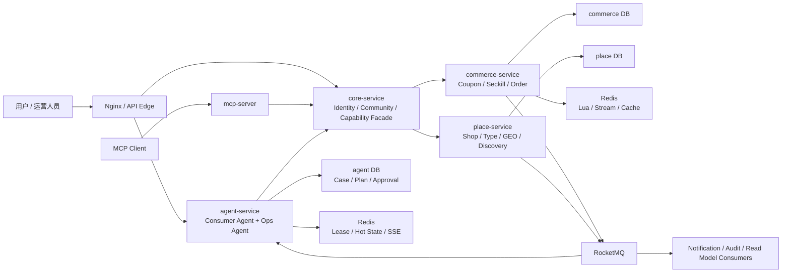
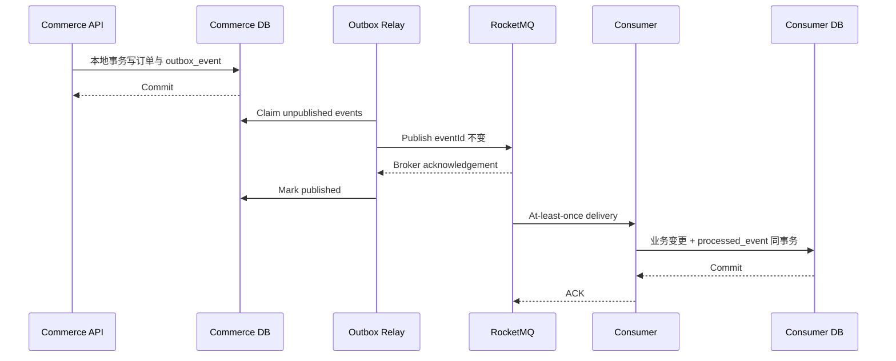
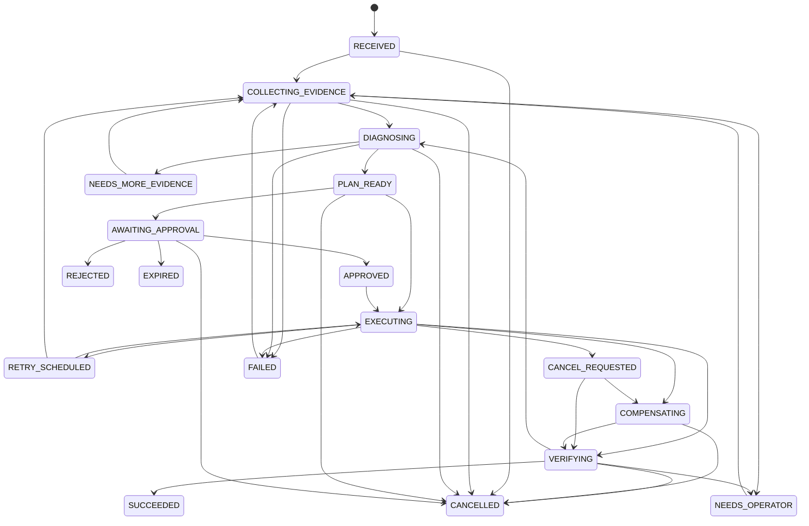

# CityCopilot 分布式交易与可信双 Agent 架构演进计划

- 状态：`Proposed`
- 版本：`v1.0`
- 日期：`2026-07-26`
- 基线性质：`2026-07-26 历史快照；不是当前工作树说明`
- 目标读者：项目维护者、Java 后端/AI Agent 面试官、后续实施 Agent
- 实施分支约束：遵循仓库 `AGENTS.md`，默认只在 `main` 工作；本文不授权自动提交或推送

## 1. 文档目的

本文记录 CityCopilot 从 `2026-07-26` 的 `Core + Agent + MCP` 基线，演进为“高并发本地生活交易平台 + 可信双 Agent + 有边界的事件驱动微服务”的实施路线。当前实现事实以 [README](../../README.md)、[后端模块说明](../../backend/README.md)、[Commerce 边界 ADR](../adr/0006-commerce-place-service-boundaries.md) 和 [mutation coverage](commerce-mutation-coverage.md) 为准。

它解决的不是“如何把更多技术名词放进项目”，而是以下三个相互关联的问题：

1. 如何保留 Redis 在 GEO、缓存、限流和秒杀原子链路中的优势；
2. 如何用专用消息队列解决跨服务广播、延迟任务、独立消费组、重试和死信治理；
3. 如何让 Consumer Agent 与 Ops Agent 分别形成可执行、可恢复、可审批、可验证的真实闭环。

本文是实施计划，不代表其中目标已经完成。所有性能数字均为待验证目标，不是现状声明。

## 2. 一句话定位

> CityCopilot 是面向本地生活场景的可信双 Agent 分布式交易系统：Consumer Agent 帮用户完成发现与交易，Redis 承担热点与秒杀入口，RocketMQ 传播跨服务领域事件，Ops Agent 根据可验证证据诊断并修复运行异常。

典型端到端场景：

```text
用户说“帮我找附近评分高且有秒杀券的店并下单”
  → Consumer Agent 查询店铺和优惠券
  → 用户确认高风险操作
  → Commerce 执行 Redis Lua 秒杀资格与库存预扣
  → Redis Stream 驱动服务内落单
  → MySQL 订单事务同时写 Outbox
  → RocketMQ 发布 OrderCreated
  → 通知、审计和读模型独立消费
  → 库存对账发现异常并发布 StockDiscrepancyDetected
  → Ops Agent 收集证据、诊断、生成计划、等待审批、执行修复并复核
```

## 3. 状态说明

本文使用三种状态，避免把源码、历史记录和未来目标混为一谈：

| 标签 | 含义 |
|---|---|
| `CURRENT-CODE` | 仅指本文创建时（2026-07-26）的工作树快照 |
| `CURRENT-VERIFIED` | 仅指本文创建时或紧邻当时实际运行的结果 |
| `TARGET` | 尚未实现或尚未验证的目标 |

## 4. 2026-07-26 历史基线

### 4.1 仓库与工作树

截至 2026-07-26，本计划文档创建前：

- `CURRENT-CODE`：当前分支为 `main`，HEAD 为 `e9a4436`。
- `CURRENT-CODE`：工作树有 268 个状态条目，其中 142 个修改、57 个删除、69 个未跟踪。
- `CURRENT-CODE`：现有 Core/Agent/MCP、Compose、ADR 和大部分升级成果尚未全部形成干净提交基线。

因此，所有结构性重构开始前必须先完成 E0 基线收敛。禁止在未审阅的情况下把 268 个条目整体提交，也禁止通过 `reset --hard` 或覆盖式 checkout 清理用户改动。

### 4.2 当时部署拓扑

`CURRENT-CODE`：

| 组件 | 当前职责 | 当前数据访问 |
|---|---|---|
| `core-service` | 业务 API、店铺、内容、优惠券、订单、秒杀、权限、审计、内部 Tool API | MySQL、Redis DB 0 |
| `agent-service` | Consumer Agent、Ops Agent、LLM 编排、SSE、Trace、会话与 pending action | Redis DB 1，不访问业务 MySQL |
| `mcp-server` | 无状态 MCP/HTTP 适配器 | 通过内部 HTTP 调用 Core |
| `eval` | YAML 用例、离线预测与 Markdown 报告 | 测试模块，不是运行时服务 |
| `contracts` | Tool、安全与远程调用契约 | 代码制品，不是运行时服务 |
| `frontend` | Web UI 与 Nginx 统一入口 | 通过 HTTP 调用 Core/Agent |
| `mysql` | 当前全部业务权威数据 | 单实例、命名卷 |
| `redis` | Core DB 0、Agent DB 1、秒杀 Stream | 单实例、AOF、命名卷 |

相关依据：

- [README](../../README.md)
- [后端模块说明](../../backend/README.md)
- [Compose 配置](../../compose.yaml)
- [ADR-0004：拆分 Core 与 Agent](../adr/0004-core-agent-service-boundary.md)

当前得到的是独立进程、独立重启和独立扩缩容入口，不是多主机高可用。

### 4.3 当时可保留资产

`CURRENT-CODE`：

- `contracts` 已将 Tool 契约与 Core 实现解耦。
- Agent 通过版本化 `/internal/v1` HTTP API 远程调用 Core。
- ToolGateway 已有权限、参数校验、审计、限流、幂等和 Resilience4j 入口。
- Consumer Agent 已有 ReAct、Plan-Execute、SSE、会话记忆和 HITL 基础。
- Redis Lua 已原子完成秒杀资格判断、库存预扣、一人一单与 `XADD`。
- 秒杀消费已有重试、Redis DLQ、Micrometer 指标与库存对账。
- Compose 已包含 MySQL、Redis、Core、Agent、MCP 和 Frontend。
- CI 已配置 Maven `clean verify` 与前端生产构建。
- 已有 JMeter、Testcontainers、MCP/Ops/Observability smoke 脚本。

代码锚点：

- [Commerce 秒杀 Lua](../../backend/commerce-service/src/main/resources/lua/commerce_seckill.lua)
- [Commerce 订单事务](../../backend/commerce-service/src/main/java/com/citycopilot/commerce/CommerceOrderService.java)、[准入与持久恢复](../../backend/commerce-service/src/main/java/com/citycopilot/commerce/CommerceOrderAdmissionService.java)、[Redis Stream 消费与补偿](../../backend/commerce-service/src/main/java/com/citycopilot/commerce/CommerceOrderStreamWorker.java)
- [Commerce 库存对账](../../backend/commerce-service/src/main/java/com/citycopilot/commerce/CommerceReconciliationJob.java)
- [远程 ToolGateway](../../backend/agent/src/main/java/com/citycopilot/agent/gateway/RemoteToolGateway.java)
- [Ops Agent 当前实现](../../backend/agent/src/main/java/com/citycopilot/agent/ops/OpsAgentService.java)

### 4.4 当时验证边界

`CURRENT-VERIFIED`：

| 检查 | 最近结果 | 不能推出什么 |
|---|---|---|
| `mvn -q -DskipITs test` | 75 个单元测试，0 失败，3 跳过 | 不能证明 Docker、Testcontainers、MQ 或真实服务联调 |
| `npm run build` | 通过 | 不能证明浏览器端完整业务流程 |
| 离线 eval | 30/30 | 当前预测器与规则存在闭环性，只能作为路由回归，不等于真实 Agent 质量 |
| Docker/Compose | 本轮 Docker daemon 不可用 | 不能复用旧记录声称当前完整栈健康 |
| 真实 LLM/provider | 未运行 | 不能声称真实多轮 Agent 与 LLM Judge 已通过 |

未来每个阶段必须重新生成自己的验证证据，不能引用此表替代阶段验收。

### 4.5 当时阻断性缺口

| 编号 | 缺口 | 风险 | 主要位置 |
|---|---|---|---|
| B1 | Core 将正常返回的 `Result.fail()` 包装成 Tool 成功 | Agent 可能在业务失败后继续执行或错误复核 | [CoreToolInvocationService](../../backend/core/src/main/java/com/citycopilot/core/tool/CoreToolInvocationService.java) |
| B2 | Ops HTTP 入口缺少显式运营权限门禁 | 未授权任务可能进入高权限链路 | [OpsAgentController](../../backend/agent/src/main/java/com/citycopilot/agent/ops/OpsAgentController.java) |
| B3 | Ops 根据 `serviceActor` 自建高权限身份 | 服务身份与凭据未可靠绑定 | [CoreToolInvocationService](../../backend/core/src/main/java/com/citycopilot/core/tool/CoreToolInvocationService.java) |
| B4 | 高风险工具在执行器中维护硬编码集合 | Consumer Agent、Ops Agent、MCP 策略可能漂移 | [PlanExecuteExecutor](../../backend/agent/src/main/java/com/citycopilot/agent/executor/PlanExecuteExecutor.java) |
| B5 | `PendingAction` 只保存单次工具调用 | 批准后不能恢复原计划、依赖步骤和复核动作 | [PendingAction](../../backend/agent/src/main/java/com/citycopilot/agent/confirmation/PendingAction.java) |
| B6 | Ops Agent 是固定任务 `switch`，工具成功即认为任务成功 | 缺少证据、诊断、动态计划、审批和业务后置条件复核 | [OpsAgentService](../../backend/agent/src/main/java/com/citycopilot/agent/ops/OpsAgentService.java) |
| B7 | Ops Stream 缺少 pending reclaim、可靠结果提交与系统化 DLQ | 崩溃、重复投递或 ACK 时序可能丢任务或重复动作 | [OpsAgentService](../../backend/agent/src/main/java/com/citycopilot/agent/ops/OpsAgentService.java) |
| B8 | Tool 元数据缺少副作用、风险、受众和审批策略 | 模型与不同入口无法共享统一的安全决策 | [ToolDefinition](../../backend/contracts/src/main/java/com/citycopilot/contract/tool/ToolDefinition.java) |
| B9 | 当前没有 Outbox、Inbox 或专用 MQ | 跨服务事件一致性、广播与积压治理尚未建立 | [数据库迁移来源](../database-migrations.md) |
| B10 | 秒杀 Worker 使用固定消费者名，业务拒绝可能正常返回后 ACK，当前 pending 恢复不能可靠接管死亡实例 | Redis 已预扣但数据库未落单时可能长期依赖对账，且多实例恢复语义不足 | [VoucherOrderServiceImpl](../../backend/core/src/main/java/com/citycopilot/core/service/impl/VoucherOrderServiceImpl.java) |

B1–B5 是引入更多分布式组件前的 P0 级前置条件；B10 必须在 RocketMQ walking skeleton 之前解决。

当前 `SeckillConcurrencyIT` 主要验证 Lua 准入，再由测试代码读取 Stream 并落库；它没有覆盖生产 Worker 的 ACK、pending reclaim、重试、DLQ 和补偿。因此后续不能只复用现有“200 并发”结果证明新的分布式链路。

## 5. 目标与非目标

### 5.1 必须达成

1. 秒杀入口保持无超卖、一人一单和稳定幂等。
2. MQ 至少一次投递时，重复消息不产生重复业务副作用。
3. 数据库事务成功但进程在 MQ 发布前崩溃时，事件最终仍能发布。
4. Consumer Agent 和 Ops Agent 的高风险写操作都必须经过确定性策略与真实主体审批。
5. Ops Agent 必须依据结构化证据诊断，并在执行后重新取证。
6. 每个服务只读写自己拥有的数据；禁止共享表写入和跨库 Join。
7. 单服务、消费者或 Agent 实例重启后，工作可以从最后已提交状态恢复。
8. Trace 能串联用户请求、Tool、订单、MQ 事件、Ops Case、审批和执行。
9. 每项“高并发、可靠性或 Agent 能力”都必须有可重复的测试或演示证据。

### 5.2 明确不做

- 不进行一次性“大爆炸”微服务拆分。
- 不把 `contracts`、`eval`、MCP 协议适配器包装成领域微服务。
- 不在第一阶段拆分优惠券、秒杀库存和订单事务边界。
- 不宣称 RocketMQ 或业务链路实现端到端 exactly-once。
- 不同时向 Redis Stream 和 RocketMQ 无事务双写同一个关键事件。
- 不为简历关键词同时引入 Nacos、Seata、集群编排平台、服务网格和多个 MQ。
- 不让 LLM 直接发送 MQ、执行任意 SQL、Shell 或任意 HTTP。
- 不把单机 Compose 多容器描述为多主机高可用。
- 不把未运行的 Testcontainers、真实模型、故障注入或压测写成完成结果。

### 5.3 约束与待验证假设

| 项目 | 当前约束或假设 | 验证方式 |
|---|---|---|
| 团队 | 以单人开发维护为主，复杂度预算有限 | 每阶段控制部署单元与新增依赖数量 |
| 运行环境 | 本地 Windows + Docker Compose 是主要演示环境 | E0 记录机器、Docker、JDK、资源和启动耗时 |
| 技术依赖 | 版本以[父 POM](../../pom.xml)和 [Compose](../../compose.yaml)为准 | 升级及持久化契约兼容遵循 [ADR 0011](../adr/0011-supported-dependencies-and-wire-compatibility.md) |
| 流量 | 尚无真实生产峰值 | 先建立可复现基线，再确定容量和 SLO |
| 兼容性 | 对外 HTTP 路径、Tool 名和 MCP 能力尽量保持 | 契约 fixture 与旧客户端 smoke |
| MQ | RocketMQ 5.x 能满足订单事件、延迟和 Ops 触发 | E2 walking skeleton 与故障注入 |
| Agent | 真实 LLM 可输出受 schema 约束的诊断和计划 | scripted 与 live provider 评测分开 |
| 高可用 | 单机 Compose 不具备主机级 HA | 只有多故障域测试后才允许 HA 声明 |

## 6. 架构决策

### 6.1 演进方式

| 方案 | 简洁性 | 分布式能力 | 可信度 | 实施风险 | 结论 |
|---|---:|---:|---:|---:|---|
| 保持当前双服务，只加更多 AI 对话 | 5 | 2 | 2 | 2 | 无法解决跨服务事件与 Ops 闭环 |
| 一次性拆成大量微服务 | 1 | 5 | 2 | 5 | 容易成为分布式单体 |
| Walking Skeleton + Strangler Fig | 4 | 4 | 5 | 3 | **采用** |

实施策略：

1. 先在现有边界中建立可靠事件链；
2. 用一条真实 Ops Agent 闭环验证设计；
3. 再通过 Strangler Fig 抽出 `commerce-service`；
4. 只有在指标触发时继续抽出 `place-service` 或独立 Ops Worker。

### 6.2 消息系统

采用“Redis + RocketMQ 分层共存”：

| 需求 | Redis Stream | RocketMQ |
|---|---|---|
| Lua 内原子追加秒杀命令 | **保留** | 无法参与 Redis Lua 原子执行 |
| 服务内低延迟工作队列 | **适用** | 可用但不是首选理由 |
| 跨服务领域事件 | 不作为长期主总线 | **采用** |
| 多消费组广播 | 能做但治理较弱 | **采用** |
| 延迟取消、FIFO、重试、DLQ | 需要自建 | **采用** |
| 长时间积压、独立治理、可观测性 | 有限 | **采用** |

RocketMQ 事务消息只能保证生产方本地事务与消息状态的协调，不保证下游消费结果；消费者幂等仍是必须项。

本决策将通过后续 `ADR-0005` 补充或取代 [ADR-0002](../adr/0002-redis-stream-over-message-queue.md)。ADR-0002 在当时约束下是合理决策，不应被描述为“原方案错误”。

### 6.3 一致性策略

采用：

- 单服务内：本地 MySQL 事务、Redis Lua、条件更新、唯一约束；
- 跨服务：Transactional Outbox + at-least-once MQ + Consumer Inbox + 幂等处理；
- 跨聚合流程：事件驱动编排和显式补偿，不引入全局 XA；
- 事件顺序：首版使用 Normal Topic，不依赖 Broker 顺序；消费者通过 `aggregateVersion`、状态机、版本缺口检测和权威状态重查处理重复与乱序；
- 事实源：MySQL 是长期权威状态，Redis 是派生/热状态，MQ 是传输媒介。

只有出现必须由 Broker 保证的聚合内顺序时，才为该事件族建立独立 FIFO Topic，并同时满足“同一 aggregate 串行 claim、串行发送、固定 message group 和串行消费”。不能把多实例 Relay 的普通并发发送描述为 FIFO。

推荐表述：

> Broker 提供至少一次投递，系统通过 Outbox、消费者 Inbox、唯一约束、聚合版本和幂等 Tool 实现 effectively-once business effect。

### 6.4 服务发现与网关

当前继续使用：

- 本地 Compose DNS；
- Nginx 统一外部入口；
- 配置化内部服务 URL；
- 版本化 HTTP 契约。

暂不引入 Nacos/Eureka 或 Spring Cloud Gateway。出现多主机动态实例、集中配置、灰度路由或统一网关策略的真实需求后，再建立单独 ADR。

### 6.5 Ops Agent 名称

名称固定为 **Ops Agent**。是否称为 Agent 由行为闭环决定，而不是由使用 LLM 或 MQ 决定。

真正的 Ops Agent 必须：

- 主动接收事件；
- 采集确定性证据；
- 形成可引用证据的诊断；
- 生成强类型计划；
- 通过确定性策略与审批；
- 幂等执行有界工具；
- 重新采集证据验证后置条件；
- 在失败时重试、补偿、重规划或转人工。

## 7. 目标架构

### 7.1 逻辑组件图



说明：

- E2/E3 阶段尚未拆出 Commerce/Place，逻辑边界先在当前 Core 内实现。
- E4 才物理抽出 Commerce。
- Place 和独立 Ops Worker 都是条件式后续工作。
- `core-service` 在过渡期保留外部 API 和能力门面，但不能继续直接访问已抽出服务的数据表。

### 7.2 服务边界

| 部署单元 | 所有职责 | 不允许承担 |
|---|---|---|
| `core-service` | Identity、Community、外部业务 API、过渡期能力门面、统一调用上下文 | 直接写 Commerce/Place 私有表 |
| `commerce-service` | Coupon、Seckill、Order、订单状态机、Outbox、交易幂等、Redis Stream Worker | 店铺详情权威数据、Agent 计划 |
| `place-service` | Shop、ShopType、GEO、AMap、发现与地理批任务 | 订单与库存状态 |
| `agent-service` | Consumer Agent、Ops Agent 控制面、Case/Plan/Approval、Trace | 业务表、任意数据库修复 |
| `ops-worker` | 可选；长耗时 Ops 执行与恢复 | 对话入口、策略绕过 |
| `mcp-server` | 协议映射与调用适配 | 领域状态和 Agent 编排 |

`ops-worker` 只有在以下任一条件出现时才独立部署：

- Ops backlog 明显影响 Consumer Agent 对话 P95；
- Ops 任务需要不同 CPU/内存/并发配置；
- 需要独立发布或独立故障域；
- 同一 Agent 进程内的隔舱仍不能满足容量目标。

### 7.3 数据所有权

| 领域 | 权威数据 | Redis | 事件 |
|---|---|---|---|
| Identity | `user_account`、`user_profile`、`user_checkin` | session、验证码、签到 bitmap | `UserRoleChanged` 等后续事件 |
| Community | `note`、`note_comment`、`user_follow` | feed、like、热点缓存 | 非首批拆分范围 |
| Place | `shop`、`shop_type`、`geo_batch_job*` | GEO、店铺/分类缓存 | `ShopChanged`、`GeoBatchItemFailed` |
| Commerce | 历史基线：`coupon`、`seckill_coupon`、`seckill_reservation`、`coupon_order`、`outbox_event`、`processed_event`；当前实现见 `commerce_*` 表 | 历史基线：秒杀库存、Reservation 热镜像、用户订单集合、Stream | `OrderCreated`、`OrderPaid`、`StockDiscrepancyDetected` |
| Agent | `agent_case`、`agent_evidence`、`agent_plan*`、`agent_approval`、`agent_execution` | lease、checkpoint cache、SSE cursor、短期去重 | `OpsCaseStateChanged` |

Agent 持久状态使用独立 `citycopilot_agent` 数据库和独立账号；可与业务库共享同一 MySQL 服务器以控制本地成本，但禁止共享 schema 凭据。未来迁移服务器不应影响代码契约。

跨域数据规则：

- 只传稳定 ID、事件和必要快照；
- 不建立跨服务数据库外键；
- 不跨库 Join；
- 订单展示需要店铺信息时，保存下单时的必要快照或建立事件投影；
- 读模型可冗余，写模型不可共享。

## 8. 通信与事件设计

### 8.1 同步与异步边界

使用同步 HTTP：

- 用户正在等待结果的查询；
- 下单资格检查和命令接收；
- Agent 的只读证据采集；
- 审批后的受控工具执行；
- 必须立即返回业务拒绝原因的操作。

使用 MQ：

- 已发生的领域事件；
- 不需要阻塞主请求的通知、审计和投影；
- 延迟订单检查；
- Ops Agent 的异步触发；
- 可独立重试、积压和重放的长任务命令。

禁止模型自行决定 Topic、Tag 或消息体。所有消息只能由类型化生产者或工作流端口发布。

### 8.2 统一事件信封

```json
{
  "eventId": "UUID",
  "eventType": "commerce.order.created",
  "schemaVersion": 1,
  "aggregateType": "coupon_order",
  "aggregateId": "123456",
  "aggregateVersion": 1,
  "sourceService": "commerce-service",
  "occurredAt": "2026-07-26T10:00:00Z",
  "traceId": "trace-id",
  "correlationId": "business-flow-id",
  "causationId": "command-or-parent-event-id",
  "idempotencyKey": "stable-business-key",
  "payload": {}
}
```

约束：

- `eventId` 由生产方生成，Outbox 重试发布时保持不变；
- `eventType + schemaVersion` 决定 payload schema；
- `aggregateVersion` 用于拒绝重复或旧版本状态迁移；
- `traceId` 使用 W3C Trace Context 传播；
- payload 不包含密钥、完整手机号、支付凭证等敏感数据；
- 破坏性 schema 变化必须升主版本或建立新事件类型。

### 8.3 首批 Topic

| Topic | 类型 | Message Group/Key | 首批事件或命令 |
|---|---|---|---|
| `citycopilot-commerce-events-v1` | Normal | `orderId` message key | `OrderCreated`、`OrderPaid`、`OrderCancelled`、`OrderRefunded` |
| `citycopilot-commerce-delayed-v1` | Delay | `orderId` | `CheckOrderPaymentTimeout` |
| `citycopilot-ops-events-v1` | Normal | `aggregateId` message key | `StockDiscrepancyDetected`、`CouponOrderDeadLettered`、`GeoBatchItemFailed` |
| `citycopilot-ops-commands-v1` | Normal | `caseId` message key | 经策略批准的长任务命令；Case 租约保证串行推进 |
| `citycopilot-notification-commands-v1` | Normal | `userId` message key | 交易通知；失败不回滚订单 |

Topic 数量保持克制。首个 walking skeleton 只创建 `citycopilot-commerce-events-v1` 和 `citycopilot-ops-events-v1`，同一领域内通过 Tag 区分事件。

Wire 层 `eventType` 统一使用小写命名空间形式，如 `commerce.order.created`；Java 类型可以命名为 `OrderCreated`。版本由 `schemaVersion` 独立表达。

RocketMQ Topic 的 MessageType 在创建时固定。Normal、FIFO、Delay 和 Transaction 不得在同一个 Topic 中混用。

Normal Topic 的版本处理规则：

- `aggregateVersion <= localVersion`：按重复或旧事件处理；
- `aggregateVersion == localVersion + 1`：正常应用；
- `aggregateVersion > localVersion + 1`：记录 version gap，延迟重试或从权威服务重建投影；
- 状态命令仍由领域状态机校验，不能仅凭到达顺序覆盖当前状态。

### 8.4 Outbox

建议最小字段：

```text
outbox_event
- event_id PK
- aggregate_type
- aggregate_id
- aggregate_version
- event_type
- schema_version
- payload_json
- headers_json
- status
- retry_count
- next_attempt_at
- claimed_by
- claim_token
- locked_until
- created_at
- published_at
- last_error
```

发布流程：



Relay 约束：

- 多实例用短数据库事务领取批次，写入 `claimed_by + claim_token + locked_until` 后立即提交；网络发送期间不得持有数据库行锁；
- 只有持有当前 claim token 的 Relay 才能更新发送结果；租约过期后其他实例可以接管；
- 可使用 `FOR UPDATE SKIP LOCKED` 选择候选，但它只负责短事务领取，不能把网络调用放进该事务；
- 发布失败使用指数退避和最大退避上限；
- 超过阈值进入 `FAILED` 并报警，但不物理删除事件；
- 指标至少包括未发布数量、最老事件年龄、发布延迟、重试次数和失败数；
- Outbox 清理只删除超过保留期且已确认发布的记录。

### 8.5 Consumer Inbox

每个消费者在自己的数据库中建立：

```text
processed_event
- consumer_name
- event_id
- event_type
- schema_version
- aggregate_type
- aggregate_id
- processed_at
- payload_hash
- status
PRIMARY KEY (consumer_name, event_id)
```

处理顺序：

1. 尝试插入 `processed_event`；
2. 唯一键冲突时比较 event type、schema、aggregate 和 payload hash；
3. 完全一致才视为重复投递并安全 ACK；
4. 同 eventId 不同内容必须持久化到 quarantine、产生安全告警，再 ACK 原毒消息以停止无限重投；不能计入正常消费成功；
5. 在同一事务内执行本地业务变更；
6. 本地事务提交后 ACK；
7. 提交后、ACK 前崩溃允许重新投递，但不会重复产生业务效果。

### 8.6 Redis Stream 与 RocketMQ 的桥接边界

现阶段保留：

```text
Redis Lua
  → 原子库存预扣、一人一单、XADD commerce:stream:orders
  → Commerce Stream Worker
  → MySQL 订单 + Outbox 同事务
  → RocketMQ 跨服务领域事件
```

禁止将 Lua 后的 `XADD` 直接替换成普通 MQ 网络发送，否则会形成“Redis 扣库存成功、MQ 发送失败”的一致性窗口。

只有在 Redis Stream 的故障域、积压、广播需求或治理成本经过指标证明成为瓶颈后，才单独设计库存预约状态与 Stream-to-MQ 迁移。

### 8.7 秒杀 Reservation 与补偿语义

> 历史方案说明（截至 2026-07-30）：本节描述的是已退出当前流程的 Core
> `seckill_reservation`、`confirm_reservation.lua` 和补偿 Lua。当前权威实现位于
> `commerce-service`，使用 `commerce_reservation`、Commerce Lua、Commerce Outbox
> 与 RocketMQ；下文保留用于解释演进背景，不表示旧 Core 链路仍会运行。

Redis 库存已经在订单落库前预扣，因此活动期间不能简单使用 `MySQL stock == Redis stock` 判断一致性。计划引入显式 Reservation：

```text
RESERVED → PROCESSING → ORDER_CREATED
                  └──→ RELEASE_REQUIRED → RELEASED
```

持久化表：

```text
seckill_reservation
- order_id PK
- voucher_id
- user_id
- status
- version
- reserved_at
- expires_at
- terminal_reason
- created_at
- updated_at
```

权威边界：

- Lua 返回成功到 Worker 首次落库前，Redis Reservation 与 Stream entry 是原子准入记录；
- Worker 开始处理后，MySQL `seckill_reservation` 是长期权威生命周期记录；
- Redis Reservation 是准入状态和热镜像，可由 MySQL 终态重建；
- 两份状态按稳定 `orderId` 对齐，任何差异进入对账，不能由模型猜测。

建议流程：

1. Lua 原子扣减库存、记录购买资格、写入 Stream，并写入 `reservation:{orderId}=RESERVED`；
2. Worker 领取消息后，以稳定 orderId 幂等创建或推进 MySQL Reservation 到 `PROCESSING`；
3. 成功路径在同一 MySQL 事务写订单、Reservation=`ORDER_CREATED` 和 Outbox；
4. 事务提交后执行 Redis `confirm_reservation.lua`，原子更新热状态并 ACK Stream；若此处崩溃，重投会先看到既有订单，再幂等确认并 ACK；
5. 终态业务拒绝先将 MySQL Reservation 写为 `RELEASE_REQUIRED`；
6. 执行幂等补偿 Lua，只有未补偿的 Reservation 才恢复库存和购买资格；
7. 补偿成功后将 MySQL Reservation 写为 `RELEASED`，最后 ACK；任一步崩溃都可按 DB 状态和 Redis 状态继续；
8. 暂时故障保留 pending，不 ACK，由原 Consumer 重试或其他实例 reclaim；
9. 未知执行结果先按 orderId 查询订单与 Reservation，不能盲目补偿；
10. 超时 Reservation 进入对账和人工/自动补偿流程。

`TERMINAL_REJECT` 只有在 MySQL 终态已持久化且 Redis 补偿确认成功后才允许 ACK。

对账不变量：

```text
dbRemaining = redisAvailable + validInFlightReservations
drift = dbRemaining - redisAvailable - validInFlightReservations
期望 drift = 0
```

`validInFlightReservations` 不是 Redis 与 MySQL 计数的简单并集，而是按 orderId 联合计算 `holdsInventory`：

| MySQL 订单/Reservation | Redis Reservation | `holdsInventory` | 处理 |
|---|---|---:|---|
| 订单存在或 DB=`ORDER_CREATED` | 任意，包括滞后的 `RESERVED` | 0 | DB 已扣库存；修复 Redis 热状态 |
| DB=`RELEASED` | 任意 | 0 | 补偿已完成；修复 Redis 热状态 |
| DB=`RELEASE_REQUIRED` | Redis 已有幂等 compensation marker/`RELEASED` | 0 | 先把 DB 推进为 `RELEASED` |
| DB=`RELEASE_REQUIRED` | 尚未补偿 | 1 | 继续补偿，暂不覆盖库存 |
| DB=`PROCESSING` | `RESERVED/PROCESSING` | 1 | 合法在途 |
| 无 DB 行 | SLA 内的 `RESERVED` | 1 | 尚未被 Worker 持久化 |
| 任意无法解释的冲突组合 | 任意 | UNKNOWN | 只报警并阻止自动修复 |

计算时先按 orderId 去重，再应用状态和超时阈值。DB 订单终态或已完成的补偿标记优先于滞后的 Redis 热状态；`UNKNOWN` 不得按 0 或 1 猜测。存在合法在途预占或未知冲突时，Ops Agent 不得直接覆盖 Redis 库存。

数据库还应增加一人一单兜底唯一约束。若业务允许取消或退款后重新购买，可使用由订单状态生成的 `active_purchase` 列并对 `(user_id, voucher_id, active_purchase)` 建唯一索引；哪些状态属于 active 必须以 `OrderStatus` 状态机和业务测试为准，不能直接复制魔法数字。

## 9. Ops Agent 目标设计

### 9.1 状态机



所有状态迁移携带：

```text
caseId + caseVersion + planVersion + stateVersion + leaseEpoch + actor + reason + occurredAt
```

数据库乐观锁与单调递增 `leaseEpoch` 是长期权威并发控制；Redis lease 只减少重复工作，不能代替数据库 fencing。

事件去重分为两层：

- `sourceEventId` 唯一，处理同一消息的重复投递；
- 稳定 `incidentKey = caseType + aggregateType + aggregateId + conditionGeneration` 合并同一持续异常。

数据库使用 `ops_open_incident(incident_key PK, case_id, generation)` 保证同一异常同一时间只有一个活动 Case。Case 进入终态后释放 open incident；同一对象后来再次出现的新异常使用递增 generation 创建新 Case。

取消与重试规则：

- 未执行写步骤时可直接取消；
- `EXECUTING` 期间取消只设置 `CANCEL_REQUESTED`，等待当前原子步骤结束，再验证或补偿，不能强制终止；
- 自动重试只允许 `retryable=true` 且可证明幂等的步骤；
- 人工 retry 必须记录主体和原因，并从持久化 `resumeState` 恢复；
- 已过期审批不能通过 retry 复活；
- `FAILED`、`NEEDS_OPERATOR` 的 retry 若生成新计划，必须重新审批。

补偿步骤必须已经包含在获批计划及 plan hash 中。若需要新增补偿、扩大影响范围或提高风险级别，必须生成新计划并重新审批。

### 9.2 首个闭环

首个用例固定为 `StockDiscrepancyDetected`：

1. Core/Commerce 的库存对账检测 Redis 与 MySQL 差异；
2. 业务事务或事件发布器产生标准事件；
3. Ops Consumer 通过 Inbox 去重并创建唯一 Case；
4. Evidence Collector 调用只读工具：
   - `get_seckill_consistency_snapshot`
   - `preview_seckill_stock_repair`
   - `get_order_processing_status`
   - `get_broker_consumer_health`
   - `get_dead_letter_details`
   - `query_audit_logs`
5. LLM 只能引用存在的 `evidenceId` 形成诊断；
6. Planner 输出强类型 `OpsPlan`；
7. Policy Engine 判定库存重建需要运营审批；
8. 审批绑定 `planVersion + planHash + 参数摘要`；
9. Executor 调用有界、幂等的 `repair_seckill_stock`，并要求 snapshot hash 与预期 DB version 仍然成立；
10. Verifier 调用 `verify_seckill_consistency`，再次读取 Redis、MySQL、有效在途 Reservation、订单和积压；
11. 只有 `drift == 0`、不存在超时 Reservation 且没有新增异常时才进入 `SUCCEEDED`。

工具返回 `ok=true` 不等于 Case 成功。

MQ Consumer 只负责验证事件、以 `inbox + case` 本地事务持久化并 ACK；不能在 MQ 消费线程中同步调用 LLM 或执行修复。诊断、规划、执行和复核由可恢复 Worker 领取 Case 后完成。

### 9.3 数据模型

| 表 | 核心字段 | 关键约束 |
|---|---|---|
| `agent_case` | case_id、source_event_id、incident_key、generation、type、state、resume_state、state_version、lease_epoch、severity、aggregate_id | `source_event_id` 唯一 |
| `ops_open_incident` | incident_key、case_id、generation | `incident_key` 主键，只允许一个活动 Case |
| `agent_evidence` | evidence_id、case_id、source、observed_at、expires_at、content_hash、structured_data | 不允许静默覆盖 |
| `agent_plan` | plan_id、case_id、version、diagnosis、risk_summary、expected_outcome、plan_hash | `(case_id, version)` 唯一 |
| `agent_plan_step` | step_id、plan_id、kind、tool、args、risk、policy、precondition、success_predicate | 强类型 step kind |
| `agent_approval` | approval_id、plan_id、plan_hash、actor、decision、expires_at | 计划改变后旧批准失效 |
| `agent_execution` | execution_id、step_id、idempotency_key、status、attempt、tool_call_id | 幂等键唯一 |
| `agent_state_transition` | case_id、from_state、to_state、version、actor、reason、occurred_at | 追加写审计 |

### 9.4 证据契约

```text
OpsEvidence
- evidenceId
- caseId
- sourceService
- collectorTool
- subjectType / subjectId
- observedAt / expiresAt
- collectionStatus
- structuredData
- contentHash
```

规则：

- 告警文本不是事实，只能作为采集证据的线索；
- 模型结论必须列出 `evidenceIds`；
- 证据不足只能请求补充或转人工；
- 过期证据在写操作前必须刷新；
- 外部 LLM 只接收完成脱敏的证据摘要。

### 9.5 计划契约

```text
OpsPlan
- caseId / version / planHash
- diagnosis / evidenceIds
- riskSummary / expectedOutcome
- steps[]
- rollbackStrategy
- verificationSteps[]
- expiresAt

OpsStep
- stepId
- kind: OBSERVE | ACTION | VERIFY
- tool / arguments
- dependsOn / preconditions
- riskLevel / approvalPolicy
- idempotencyKey
- timeout / retryPolicy
- successPredicate
- compensation
```

LLM 输出必须通过 JSON Schema、工具存在性、参数 schema、权限、风险和依赖图校验。校验失败不进入执行态。

`planHash` 使用版本化 canonical JSON 和 SHA-256 计算，覆盖诊断引用、步骤、参数、依赖、风险、补偿和验证条件；数据库自增 ID、展示文本和生成时间等非执行字段不得导致 hash 漂移。任何受保护字段变化都必须生成新 planVersion 并重新审批。

### 9.6 工具治理

`ToolDefinition` 和 `@AgentTool` 需要新增：

```text
audiences: CONSUMER_AGENT | OPS_AGENT | MCP
sideEffect: READ | WRITE | EXTERNAL_EFFECT
riskLevel: LOW | MEDIUM | HIGH | CRITICAL
approvalPolicy: NONE | USER | OPERATOR | TWO_PERSON | PROHIBITED
scope: USER | SHOP | CITY | SYSTEM
timeoutMs
retryPolicy
schemaVersion
resultSchema
```

策略：

| 操作 | 默认策略 |
|---|---|
| 只读证据工具 | 自动执行 |
| 有界、可逆、预授权的低风险修复 | 可配置 playbook 自动执行 |
| 库存重建、消息重放、批量任务 | 单人运营审批 |
| 退款、金额、删除、跨用户写操作 | 双人审批或禁止自动执行 |
| 任意 SQL、Shell、通用 HTTP | 禁止暴露给 Agent |

Critic Agent 只能提出风险意见，不能替代用户或运营人员授权。

### 9.7 身份与权限

- `/agent/ops/**` 必须校验 `ADMIN_ACCESS` 或更细的 Ops 权限。
- 建议逐步从粗粒度 `ADMIN_ACCESS` 收敛为 `ops:case:read`、`ops:case:create`、`ops:case:approve`、`ops:case:cancel`、`seckill:diagnose`、`seckill:repair`、`dlq:read` 和 `dlq:replay`。
- Consumer Agent、Ops Reader、Ops Executor、MCP 使用不同服务凭据。
- `serviceActor` 必须由已认证凭据映射，不能仅信任可伪造请求头。
- Ops Agent 不自行拼接权限集合。
- 每个 Tool 同时校验服务身份、用户/运营主体、audience、scope 和审批凭据。
- 审批 token 绑定 plan hash、主体、范围、过期时间和一次性 nonce。
- 日志和 Trace 不记录密钥、完整 token、完整手机号或支付敏感信息。

### 9.8 可恢复性

- MQ 重复事件只创建一个 Case；
- 两个 Ops 实例竞争时只有一个状态版本更新成功；
- 执行器在每一步提交 checkpoint；
- 重启后从最后已提交状态恢复，而不是重新生成新计划；
- 重试复用相同 idempotency key；
- 执行幂等键由 `caseId + planVersion + stepId + argsHash` 生成，参数摘要使用 SHA-256，不使用 Java `hashCode()`；
- 未知结果先重新取证，不盲目重放写操作；
- 达到最大尝试次数进入 `NEEDS_OPERATOR` 或 DLQ；
- ACK 必须发生在 Case/结果状态成功提交之后。

### 9.9 Ops API

目标 API：

```text
POST /agent/ops/cases
GET  /agent/ops/cases
GET  /agent/ops/cases/{caseId}
GET  /agent/ops/cases/{caseId}/events
POST /agent/ops/cases/{caseId}/approve
POST /agent/ops/cases/{caseId}/reject
POST /agent/ops/cases/{caseId}/cancel
POST /agent/ops/cases/{caseId}/retry
```

审批请求必须包含 `planVersion`、`planHash` 和审批原因。审批接口只推进状态，由 Worker 恢复执行；不能在 HTTP 请求线程直接调用修复工具。

当前 `/agent/ops/poll-once` 应删除或仅保留为内部测试接口，不对外部运营用户开放。

## 10. 分阶段实施计划

阶段编号使用 `E`，与旧的 [业务升级计划](../superpowers/plans/2026-07-11-citycopilot-business-upgrade.md) 中 P0–P6 区分。

### E0：基线收敛与决策冻结

目标：得到可追溯、可回退、可比较的起点。

参考工作量：1–2 人日。

#### 任务

- [x] `E0-01` 审阅当前 268 个工作树条目，按来源和功能分组。
- [ ] `E0-02` 在 `main` 上形成用户确认的基线提交；不得混入无关个人文件或密钥。
- [x] `E0-03` 运行后端单元测试、可用时运行 Testcontainers、前端构建和离线 eval。
- [x] `E0-04` 在 Docker 可用环境运行 Compose smoke，并记录容器、镜像、端口和健康状态。
- [x] `E0-05` 生成基线压测报告：场景、并发、数据量、机器、JVM、Redis/MySQL 配置、P50/P95/P99、错误率。
- [x] `E0-06` 新建 ADR 草案：
  - ADR-0005：Redis Stream 与 RocketMQ 分层；
  - ADR-0006：Commerce/Place 服务边界与数据所有权；
  - ADR-0007：Ops Agent 证据、审批与复核模型。
- [x] `E0-07` 定义功能开关和回滚开关，不立即改变默认链路。

#### 交付物

- 干净、可识别的 Git 基线；
- 基线测试与压测报告；
- 三份 ADR；
- 功能开关清单。

#### 验收

- `git status --short` 只包含用户明确保留的后续工作；
- 后端与前端基线命令结果已保存；
- Docker 不可用时明确标记 `not_run`，不以跳过代替通过；
- 每个后续阶段都有独立开关或明确回滚点。

#### 回滚

E0 不改变运行时行为。回滚仅撤销新增文档或未启用配置。

### E1：可信 Tool 与 Agent 安全基线

目标：在引入 MQ 前消除错误成功、越权和审批断链。

参考工作量：3–5 人日。

依赖：E0。

#### 任务

- [x] `E1-01` 修复 `Result.fail()` 到 `ToolInvocationResponse.failure()` 的映射。
- [x] `E1-02` 为业务错误建立稳定 code、retryable 和 HTTP/Tool 语义。
- [x] `E1-03` 扩展 Tool 元数据：audience、sideEffect、risk、approval、scope。
- [x] `E1-04` 删除 `HIGH_RISK_TOOLS` 等重复硬编码，集中到 `ToolPolicyEngine`。
- [x] `E1-05` 为 `/agent/ops/**` 加运营权限与接口级测试。
- [x] `E1-06` 将服务凭据与 actor 绑定；不同服务使用不同 credential。
- [x] `E1-07` 把 `PendingAction` 升级为可恢复的 Plan Checkpoint，保存 planVersion、planHash、currentStep、evidenceIds 和 verificationSteps。
- [x] `E1-08` 确认后恢复同一计划，不再只执行孤立 Tool。
- [x] `E1-09` 计划变化、参数变化、审批过期或重复审批全部拒绝。
- [x] `E1-10` Consumer Agent 与 Ops Agent 采用不同工具 allowlist。
- [x] `E1-11` 修复 Tool 参数全部被声明为必填和基础类型 schema 表达不足的问题，增加契约版本与结果 schema。
- [x] `E1-12` 将 `/agent/ops/poll-once` 收为内部测试能力，禁止公网或普通运营调用。

#### 测试

- `Result.fail` 必须立即终止后续步骤；
- 未登录、普通用户、伪造 actor 均不能访问 Ops；
- Consumer Agent 不能看到 Ops Tool；
- MCP 不能调用未声明为 MCP audience 的 Tool；
- 计划 hash 不匹配、过期、重复和跨主体审批均失败；
- 同一批准请求重复十次，只恢复一次原计划；
- 工具返回成功但验证失败时，不得标记计划成功。

#### 验收

- 不存在未审批的高风险写路径；
- 未授权 Ops 写操作数为 0；
- Tool 风险策略只有一个权威来源；
- 现有 Consumer Agent 回归测试保持通过。

#### 回滚

- 新元数据先提供兼容默认值；
- 新策略以 feature flag 对指定工具逐步启用；
- 出现兼容问题时回到旧执行器，但不得回退 B1/B2 安全修复。

### E2：秒杀可靠性加固与 RocketMQ Walking Skeleton

目标：先补齐现有 Redis Stream 的 ACK、接管和补偿语义，再在不拆服务的前提下证明可靠跨服务事件链。

参考工作量：9–14 人日。

依赖：E1。

工作包：

| 工作包 | 内容 | 参考工作量 |
|---|---|---:|
| E2A | Redis Worker、Reservation、补偿、唯一约束和恢复 | 4–6 人日 |
| E2B | Event、Outbox/Inbox、RocketMQ、Compose、指标和故障注入 | 5–8 人日 |

#### 任务

- [x] `E2-01` 为每个 Redis Stream Worker 生成唯一 consumer name。
- [x] `E2-02` 使用 `XAUTOCLAIM` 或等价机制接管死亡实例的超时 pending。
- [x] `E2-03` 将订单处理结果改为 `ORDER_CREATED / ALREADY_CREATED / TERMINAL_REJECT / RETRYABLE_FAILURE` 等结构化结果；只有可确认完成的结果才能 ACK。
- [x] `E2-04` 建立 MySQL `seckill_reservation`、Redis 热镜像、幂等确认/补偿 Lua 和崩溃恢复，覆盖 Redis 预扣后数据库终态失败。
- [x] `E2-05` 增加数据库一人一单兜底唯一约束、订单版本和真实 processing/failed/completed 查询状态。
- [x] `E2-06` 建立 DLQ 查询、审批后重放和重放审计；旧 Worker 与新 Worker 不得同时消费。
- [x] `E2-07` 在 `contracts` 定义无 Broker 依赖的 Event Envelope 和首批事件 schema。
- [x] `E2-08` 在业务数据库加入 `outbox_event`。
- [x] `E2-09` 实现带 claim token、lease、fencing 的 Outbox Repository/Relay、重试、保留和指标；网络发送不持 DB 锁。
- [x] `E2-10` 接入 RocketMQ 5.x Java gRPC SDK，并锁定经验证的服务端/SDK 版本。
- [x] `E2-11` 在 Compose 增加单节点 NameServer、Broker、Proxy；Dashboard 放入可选 profile。
- [x] `E2-12` 首先发布 `OrderCreated`，与订单在同一 MySQL 事务写 Outbox。
- [x] `E2-13` 建立 `event-audit` 消费组与 Inbox，完成最薄消费者；同 eventId 不同 payload 必须隔离告警。
- [x] `E2-14` 增加 `citycopilot-commerce-events-v1` 与 `citycopilot-ops-events-v1`。
- [x] `E2-15` 传播 traceId、correlationId、causationId。
- [x] `E2-16` 增加生产、消费、lag、ready age、retry、DLQ、Reservation 与 Outbox 指标。
- [x] `E2-17` 保留 Redis Lua + Stream 秒杀链路，不在本阶段迁移为 MQ。

#### 故障注入

- Lua 成功后、数据库事务前杀死 Worker；
- Worker 读取消息后死亡，由另一实例接管 pending；
- 同一 Stream 消息重复处理十次；
- 订单和 DB Reservation 提交后、`confirm_reservation.lua` 前杀死 Worker；
- 终态拒绝后补偿重复执行十次；
- 补偿 Lua 成功后、DB 推进为 `RELEASED` 前杀死 Worker；
- DB 提交后、Relay 发布前杀进程；
- Broker ACK 后、Outbox 标记前杀 Relay；
- Relay 持有 claim 时死亡，租约到期后由另一 Relay 以新 fencing token 接管；
- 消费事务提交后、ACK 前杀 Consumer；
- 同一 eventId 重放十次；
- 同一 eventId 注入不同 payload/hash；
- 同一 orderId 注入重复和旧版本消息；
- 注入毒消息直至 DLQ；
- Broker 短时不可用后恢复。

#### 验收

- 同一 Stream 消息重复处理不会重复建单或重复扣减数据库库存；
- Worker 实例死亡后，其他实例可接管超时 pending；
- 终态失败会幂等释放库存和购买资格；
- 合法在途 Reservation 不会被库存对账误判并覆盖；
- DB 已 `ORDER_CREATED` 但 Redis 状态滞后时不产生假 drift，并能修复热镜像；
- Redis 补偿已生效但 DB 仍为 `RELEASE_REQUIRED` 时不产生假 drift，并能完成 DB 状态推进；
- 无法解释的 DB/Redis Reservation 冲突会阻止自动库存修复；
- 订单查询能区分处理中、成功和终态失败；
- Outbox 最终发布率达到 100%，或明确进入可告警失败态；
- 同一 eventId 重放十次，业务副作用仍为一次；
- 旧 aggregateVersion 不覆盖新状态；
- 同 eventId 不同内容进入 quarantine 并告警，不产生业务副作用；
- 毒消息进入 DLQ，其他消息和消费组继续消费；
- 单节点 Compose 只标记“集成通过”，不标记 HA；
- 关闭 MQ feature flag 后，原同步业务和 Redis Stream 秒杀仍可运行。

#### 回滚

- 新旧 Redis Worker 通过互斥开关切换，禁止同时运行；
- Reservation 和新增列采用 expand-only 迁移；
- Outbox 写入可保留但 Relay 停止；
- 消费者可以独立停用；
- 订单主事务不依赖消费者在线；
- 不通过删除 Outbox 记录回滚。

### E3：第一个真实 Ops Agent 闭环

目标：用 `StockDiscrepancyDetected` 证明 Ops Agent 名副其实。

参考工作量：11–18 人日。

依赖：E1、E2。

工作包：

| 工作包 | 内容 | 参考工作量 |
|---|---|---:|
| E3A | Agent DB、Case 状态机、租约、权限、审批和恢复骨架 | 5–8 人日 |
| E3B | 库存差异 Evidence/LLM/Plan/Tool/Verifier、前端和 E2E | 6–10 人日 |

#### 任务

- [x] `E3-01` 建立独立 Agent 数据库、账号和迁移脚本。
- [x] `E3-02` 建立 Case、Evidence、Plan、Approval、Execution 和 Transition 表。
- [x] `E3-03` 实现 Ops Event Inbox 与唯一 Case 创建。
- [x] `E3-04` 按 Reservation 不变量修正库存对账，并把持续差异升级为 `StockDiscrepancyDetected`。
- [x] `E3-05` 实现只读 Evidence Collector 与证据有效期。
- [x] `E3-06` 实现结构化 Diagnosis/Plan LLM 接口；无 LLM 时转人工，禁止伪造计划。
- [x] `E3-07` 实现 Plan Validator 与 `ApprovalPolicyEngine`。
- [x] `E3-08` 实现审批 API/卡片、plan hash 绑定和一次性消费。
- [x] `E3-09` 实现 `get_seckill_consistency_snapshot`、`preview_seckill_stock_repair`、`repair_seckill_stock` 和 `verify_seckill_consistency` 四个有界工具。
- [x] `E3-10` 实现独立 Verifier，重新采集 MySQL、Redis、Reservation、订单和 MQ 证据。
- [x] `E3-11` 实现乐观锁、Redis lease、checkpoint、重试、DLQ 和重启恢复。
- [x] `E3-12` 把当前 `switch` 任务作为兼容适配器逐步下线。
- [x] `E3-13` 前端提供 Case 时间线、证据、计划差异、审批和复核结果。
- [x] `E3-14` 将 Ops Reader 与 Ops Executor 身份、凭据和线程池分离。
- [x] `E3-15` 增加 incidentKey/open-case fencing、取消、人工 retry 和补偿审批语义。

#### 验收

- 同一事件十次投递只创建一个 Case；
- 同一持续异常产生不同 eventId 时仍只保留一个活动 Case；
- 两个 Ops 实例并发时只允许一个状态版本成功；
- 任意持久化状态后杀进程，重启可继续；
- 缺证据、未知工具、越权工具和过期审批均不能触发写操作；
- 工具成功而业务后置条件失败时进入重规划或人工处理；
- 执行中取消不会截断原子写步骤，未获批的新补偿不能执行；
- 业务异常消除并有新证据时才能进入 `SUCCEEDED`；
- 未审批写操作、重复副作用、无证据成功结论均为 0。

#### 回滚

- 保留旧 Ops task API 作为只读或 plan-only 兼容入口；
- `OPS_AGENT_V2_ENABLED=false` 时停止消费新 Ops 事件；
- 已创建 Case 保留审计，不物理删除；
- 不允许通过回滚恢复旧的高权限自动写行为。

### E4：抽出 Commerce Service

目标：形成第一个有真实数据所有权、独立发布与故障隔离价值的领域微服务。

参考工作量：8–14 人日。

依赖：E0–E3 稳定。

#### 范围

一起迁移：

- `coupon`
- `seckill_coupon`
- `seckill_reservation`
- `coupon_order`
- 订单状态机
- 秒杀 Lua、Redis Stream Worker、DLQ、对账
- 交易 Outbox/Inbox
- 与交易直接相关的 Tool

暂不拆分 Promotion 与 Order。

#### 任务

- [x] `E4-01` 在 Core 内先建立 Commerce Port，禁止新代码绕过端口访问 Mapper。
- [x] `E4-02` 定义版本化 Commerce HTTP/Tool 契约和错误码。
- [x] `E4-03` 新建 `commerce-service` Maven 模块和可执行应用。
- [x] `E4-04` 新建 `citycopilot_commerce` 数据库与独立账号。
- [x] `E4-05` 迁移表、索引、唯一约束和 Outbox/Inbox。
- [x] `E4-06` Redis key 全部增加 commerce namespace；不依赖逻辑 DB 作为长期隔离。
- [x] `E4-07` 将秒杀 Lua 与 Stream Worker 一起迁移，禁止跨服务拆开。
- [x] `E4-08` 订单保存必要的店铺/优惠券快照，移除跨域数据库 Join。
- [x] `E4-09` 优惠券创建/修改通过 Place 权威接口校验店铺存在和商户归属；Place 不可用时 fail closed。
- [x] `E4-10` 建立非权威 `shop_summary_projection` 用于展示和预检查，但不得替代最终授权。
- [x] `E4-11` Core Capability Facade 改为调用 Commerce API，不访问 Commerce 私有表。
- [x] `E4-12` Agent/MCP 对外 Tool 名保持兼容；先由 Core 门面转发，稳定后再评估 `CompositeRemoteToolGateway` 按 ownerService 直连。
- [x] `E4-13` Commerce 使用独立数据库凭据与 Redis namespace/ACL。
- [x] `E4-14` Compose 增加 Commerce 容器、健康检查、资源限制和独立凭据。
- [x] `E4-15` 建立迁移核对：行数、主键范围、金额/库存汇总、抽样 hash。
- [x] `E4-16` 建立 mutation coverage matrix，覆盖优惠券新增/修改、秒杀配置、订单创建/支付/取消/核销/退款、Reservation 和库存调整。
- [x] `E4-17` 选择迁移专用 Outbox change feed 或 binlog CDC，定义旧/新 Relay owner、claim fencing 和顺序语义。
- [x] `E4-18` 定义切换时未发布 Outbox、处理中 Reservation、Redis pending 与 DLQ 的归属和迁移脚本。

#### 切换前置门禁

在线增量迁移只有在以下条件全部满足时才允许：

- mutation coverage matrix 的每条写路径都有可验证 change record；
- change feed 对每个聚合携带单调版本；
- 同一时刻只有一个 migration relay owner；
- 未发布 Outbox 和失败 change record 均可枚举、重试和核对；
- shadow read 已覆盖关键查询；
- 切换脚本能 fencing 旧 writer、旧 Worker 和旧 Relay。

若任一条件不满足，E4 只能采用完整维护窗口：停止写入、排空队列、离线复制、核验后切换，不能假设已有 Outbox 足以同步全部增量。

#### 数据切换

1. 创建新 schema；
2. 旧 Core 保持唯一权威写者并进行全量回填；
3. 通过已通过 coverage gate 的迁移专用 Outbox change feed 或 CDC 将后续增量单向投影到新 schema，禁止应用层裸双写；
4. 执行行数、主键、业务汇总和 checksum 差异校验；
5. 启用 shadow read，比对结果但仍返回旧结果；
6. 在维护窗口关闭秒杀准入，等待 Redis Stream lag/pending 清零并停止旧 Worker；
7. 追平增量、重建 Commerce Redis，再次核验；
8. 先关闭旧 writer，再开启新 writer，并切换 Core 路由；
9. 运行写入、查询、秒杀和 Agent smoke；
10. 明确转移或处理切换点之前的未发布 Outbox，再切换 Relay ownership；
11. 在观察窗口内用 Commerce 事件维护旧表只读兼容副本；
12. 用户确认后再制定旧表删除计划。

不使用无事务双写作为长期迁移方案。

#### 验收

- Commerce 是相关表的唯一写入者；
- Core 代码和凭据不能直接访问 Commerce schema；
- Agent/MCP Tool 契约兼容；
- Place 不可用时历史订单仍可通过快照展示，优惠券写操作则 fail closed；
- 秒杀无超卖、一人一单、幂等、DLQ 和对账回归通过；
- Commerce 不可用时，Place、Community 和 Agent 只读能力保持可控；
- 同等基线负载下 API P95 不劣化超过预先确认阈值；
- 回滚演练成功一次。

#### 回滚

- 切换窗口内可将路由恢复到旧 Core；
- 旧表保持只读且数据差异已记录；
- 新服务写入开始后若需要回滚，必须执行反向增量同步或维护窗口，不能直接切回旧数据。

### E5：条件式 Place 拆分与 Ops Worker 隔离

目标：只在指标证明有价值时继续拆分。

参考工作量：每项 6–10 人日；默认不进入必做范围。

#### Place 拆分触发条件

- GEO/搜索流量与交易流量有明显不同的扩缩容曲线；
- AMap 延迟或批任务故障影响交易 API；
- 店铺索引重建需要独立发布/资源；
- Commerce 抽取完成并稳定至少一个里程碑。

#### Place 任务

- [ ] 抽取 `shop`、`shop_type`、`geo_batch_job*`；
- [ ] 独占 place schema、GEO key namespace 与 AMap 配置；
- [ ] 用 `ShopChanged` 维护订单/展示读模型；
- [ ] Core 不再跨库读取店铺；
- [ ] 迁移时重建缓存与 GEO，不复制旧缓存；预热完成后再放开附近搜索流量；
- [ ] 若 Geo Batch 使用 MQ，多实例通过 `(jobId, shopId)` 唯一约束保持幂等，并继续使用全局外部 API 限流；
- [ ] 对 AMap 限流、熔断和批任务做独立容量测试。

#### Ops Worker 拆分触发条件

- Ops backlog 影响对话服务延迟；
- Ops 任务具有显著不同的资源或发布周期；
- 需要两个以上 Worker 实例并独立扩缩容。

未触发条件时，Consumer Agent 与 Ops Agent 继续在同一个 `agent-service` 中，通过线程池、队列、权限和状态边界隔离。

### E6：验证、可观测性与作品集交付

目标：将实现转化为可重复证据，而不是简历口号。

参考工作量：3–5 人日。

依赖：至少完成 E0–E3；完成 E4 后增加微服务专项。

#### 测试矩阵

| 层级 | 工具/形式 | 必须覆盖 |
|---|---|---|
| Unit | JUnit | 状态机、策略、schema、幂等、版本比较 |
| Contract | 生产者/消费者 fixture | Tool/Event 向前兼容 |
| Integration | Testcontainers | MySQL、Redis、RocketMQ、Outbox/Inbox |
| Component | Spring Boot Test | 服务 API、认证、数据库所有权 |
| Compose | smoke scripts | 健康、路由、依赖恢复 |
| Performance | JMeter/自定义脚本 | 秒杀入口、Outbox Relay、Consumer lag |
| Failure injection | 进程终止/网络中断 | 提交与 ACK 边界、重启恢复 |
| Agent eval | scripted + optional live | 证据引用、计划正确性、审批、复核 |

#### 核心不变量

- 超卖数 = 0；
- 重复业务副作用数 = 0；
- 未审批高风险写操作数 = 0；
- 无证据即成功的 Ops Case 数 = 0；
- 复核失败却标记成功的 Case 数 = 0；
- 跨服务私有表写入数 = 0。

#### 建议观测指标

交易：

- 请求吞吐、P50/P95/P99、错误率；
- Lua 拒绝原因；
- Redis Stream pending、retry、DLQ；
- Redis/MySQL 库存差异；
- 订单状态迁移冲突。

MQ：

- publish RT/error；
- ready/inflight 数；
- oldest ready message age；
- consumer lag、retry、DLQ；
- Outbox unpublished count/age；
- Inbox duplicate count。

Agent：

- event-to-diagnosis latency；
- evidence collection success；
- plan validation failure；
- approval wait；
- execution success；
- verification pass；
- replan、manual handoff、MTTR；
- 未授权尝试和策略拒绝。

Metrics Tag 禁止使用 caseId、orderId、eventId、userId 等高基数字段；这些标识进入 Trace 或结构化日志。

#### 建议目标

以下是待基线校准的目标，不是现状：

- 在声明负载下，事件发布 P95 小于 2 秒；
- 消费能力至少为实测峰值生产速率的 1.5 倍；
- 五分钟 Broker/Consumer 中断恢复后，积压在约定窗口内归零；
- E4 拆分后同步 API P95 相比同机器基线劣化不超过 15%；
- Ops Case 的正确性不变量全部为 0 违规。

#### 黄金演示

演示必须完整录制或脚本化：

1. 用户通过 Consumer Agent 找店、选券并确认下单；
2. 并发秒杀证明无超卖和一人一单；
3. 在 Outbox/MQ/ACK 边界杀进程并恢复；
4. 重放同一事件十次，证明无重复副作用；
5. 人为制造 Redis/MySQL 库存差异；
6. Ops Agent 收集证据、诊断、生成计划并请求运营审批；
7. 批准后修复，重新取证并展示不变量恢复；
8. Trace 页面串联 requestId、orderId、eventId、caseId、planId、approvalId 和 toolCallId。

#### CI 演进

- 保留当前 Maven 与前端 build job；
- 增加 Event/Tool 契约兼容 job；
- 在具备 Docker 的 runner 上增加 MySQL + Redis + RocketMQ Testcontainers；
- 增加 Compose smoke 和最小故障恢复脚本；
- 离线确定性 eval、scripted Agent eval、真实 provider eval 分开报告；
- 真实 provider job 默认手动或定时运行，记录模型、prompt、成本和 `not_run` 原因。

## 11. 阶段门禁与停止点

| 阶段 | 可以得到什么 | 是否可作为竞争力版本停止 |
|---|---|---|
| E0 | 可追溯基线 | 否 |
| E1 | 可信 Tool/HITL 基线 | 可作为 Agent 安全版本 |
| E2 | 可靠 MQ walking skeleton | 可作为分布式消息版本 |
| E3 | 真实 Ops Agent 闭环 | **推荐的最小竞争力版本** |
| E4 | 有数据所有权的 Commerce 微服务 | **推荐的完整后端版本** |
| E5 | 更细故障域与扩缩容 | 条件式，不必为了简历完成 |
| E6 | 可复现证据与交付 | 对外展示前必须完成对应部分 |

任何阶段只有满足以下条件才进入下一阶段：

- 本阶段验收全部通过；
- 与基线相比无未解释回归；
- 回滚步骤实际演练；
- 文档和 ADR 与实现同步；
- 未验证项明确标为 `not_run`；
- 用户确认继续扩大范围。

## 12. 工作量与依赖

| 阶段 | 参考工作量 | 依赖 | 风险 |
|---|---:|---|---|
| E0 | 1–2 人日 | 无 | 当前工作树复杂 |
| E1 | 3–5 人日 | E0 | 契约兼容和权限回归 |
| E2 | 9–14 人日 | E1 | Redis 补偿、MQ 运维与一致性细节 |
| E3 | 11–18 人日 | E1、E2 | Agent 状态、审批、LLM、前端与恢复 |
| E4 | 8–14 人日 | E0–E3 | 数据迁移和同步调用回归 |
| E5 | 每项 6–10 人日 | E4 + 指标触发 | 过度拆分 |
| E6 | 3–5 人日 | 对应实现阶段 | 环境与证据复现 |

E0–E3 预计 24–39 人日；E0–E4 预计 32–53 人日。估算按单人开发、已有代码可复用计算，不包括外部服务、Docker 或真实模型环境故障。E3 的真实 provider 调试和前端交互已单列进估算，不再视为“顺带完成”。

## 13. 风险登记

| 风险 | 概率 | 影响 | 缓解 | 触发回退 |
|---|---|---|---|---|
| 工作树基线不可追溯 | 高 | 高 | E0 分组审阅、最小提交 | 无法解释差异时停止重构 |
| 技术栈堆叠导致范围失控 | 高 | 高 | 阶段门禁、E3 最小停止点 | 单阶段连续两次延期且无业务证据 |
| Outbox/业务状态不在同一事务 | 中 | 高 | 集成测试、事务边界审查 | 任一丢事件案例 |
| Redis 已预扣但 DB 未落单后消息被错误 ACK | 中 | 高 | Reservation、结构化结果、pending reclaim、幂等补偿 | 无订单且未补偿的终态消息 |
| 重复消费产生重复业务效果 | 中 | 高 | Inbox、唯一约束、幂等键 | 重放测试出现副作用 |
| 共享数据库形成分布式单体 | 中 | 高 | 独立账号/schema、架构测试 | 服务可访问他域私有表 |
| LLM 绕过策略或生成无证据计划 | 中 | 高 | schema、Policy Engine、evidenceId | 未审批写或无证据成功 |
| RocketMQ 增加本地资源负担 | 高 | 中 | Compose profile、资源限制 | 常用开发机无法稳定运行 |
| 单机结果被误写为 HA | 中 | 中 | 文档状态标签、多故障域门禁 | 无多主机故障注入却出现 HA 声明 |
| 离线 eval 被误当真实 Agent 质量 | 高 | 中 | 分离 deterministic/live eval | 报告未注明 predictor 类型 |
| 数据迁移不可逆 | 中 | 高 | 只读回滚窗口、校验和、演练 | 行数/hash/业务汇总不一致 |
| 在线迁移 change feed 覆盖不全 | 中 | 高 | mutation coverage matrix、版本化 change record、Relay fencing | 任一写路径无对应变更记录 |

## 14. ADR 与文档清单

计划新增：

- `docs/adr/0005-redis-stream-and-rocketmq-layered-messaging.md`
- `docs/adr/0006-commerce-place-service-boundaries.md`
- `docs/adr/0007-ops-agent-evidence-approval-verification.md`
- `docs/contracts/domain-event-envelope.md`
- `docs/runbooks/rocketmq-local-operations.md`
- `docs/runbooks/outbox-recovery.md`
- `docs/runbooks/ops-agent-case-recovery.md`
- `docs/testing/distributed-failure-injection.md`
- `docs/evidence/` 下的版本化测试报告

需要更新：

- [README](../../README.md)
- [后端 README](../../backend/README.md)
- [Compose 指南](../docker-compose.md)
- [ADR-0002](../adr/0002-redis-stream-over-message-queue.md)
- [ADR-0003](../adr/0003-human-in-the-loop.md)
- [ADR-0004](../adr/0004-core-agent-service-boundary.md)

## 15. 实施任务模板

每个任务进入开发前必须补齐：

```markdown
### Task ID / 标题

- 目标：
- 当前证据：
- 改动范围：
- 明确不改：
- 数据迁移：
- 兼容策略：
- 测试：
- 故障注入：
- 观测：
- 回滚：
- 完成证据：
- 未验证边界：
```

完成证据至少包含：

- 代码或配置 diff；
- 实际运行命令；
- 测试数量与失败/跳过数量；
- 环境版本；
- 指标或日志摘要；
- 已知限制；
- 对应 ADR/文档链接。

## 16. 推荐的第一批实施任务

首个实施批次只做 E0 和 E1 的最小闭环：

1. 审阅并冻结当前基线；
2. 修复 `Result.fail` 被当作 Tool 成功；
3. 为 Tool 增加 audience、sideEffect、riskLevel、approvalPolicy；
4. 为 Ops HTTP 增加运营权限；
5. 将服务 actor 与凭据绑定；
6. 让审批恢复完整计划并执行复核；
7. 为上述行为补齐测试。

首批不添加 RocketMQ，不拆微服务。只有这批安全基线通过后，才开始 E2。

## 17. 参考资料

- [RocketMQ 事务消息](https://rocketmq.apache.org/docs/featureBehavior/04transactionmessage/)
- [RocketMQ 普通消息](https://rocketmq.apache.org/docs/featureBehavior/01normalmessage/)
- [RocketMQ FIFO 消息](https://rocketmq.apache.org/docs/featureBehavior/03fifomessage/)
- [RocketMQ 延迟消息](https://rocketmq.apache.org/docs/featureBehavior/02delaymessage/)
- [RocketMQ 消费重试与 DLQ](https://rocketmq.apache.org/docs/featureBehavior/10consumerretrypolicy/)
- [RocketMQ Java SDK](https://rocketmq.apache.org/docs/sdk/02java/)
- [RocketMQ Metrics](https://rocketmq.apache.org/docs/observability/01metrics/)
- [Debezium Outbox Event Router](https://debezium.io/documentation/reference/stable/transformations/outbox-event-router.html)
- [Redis Streams](https://redis.io/docs/latest/develop/data-types/streams/)
- [Model Context Protocol Tools](https://modelcontextprotocol.io/specification/2025-11-25/server/tools)
- [OpenTelemetry GenAI Agent Spans](https://github.com/open-telemetry/semantic-conventions-genai/blob/main/docs/gen-ai/gen-ai-agent-spans.md)

## 18. 最终完成定义

CityCopilot 的这轮演进只有在以下事实同时成立时才算完成：

- Redis 秒杀链路仍满足无超卖、一人一单和幂等；
- RocketMQ 跨服务事件在崩溃、重复、乱序和毒消息下有明确结果；
- 至少一个领域服务拥有独立数据和独立发布能力；
- Ops Agent 完成证据、诊断、计划、审批、执行、复核和恢复闭环；
- Consumer Agent 与 Ops Agent 的工具、权限和主体边界清晰；
- 所有关键链路可观测、可故障注入、可回滚；
- 对外材料只陈述已经运行并留有证据的结果。

在此之前，项目应描述为“正在按阶段演进”，而不是“已经完成分布式高可用微服务 Agent 平台”。
