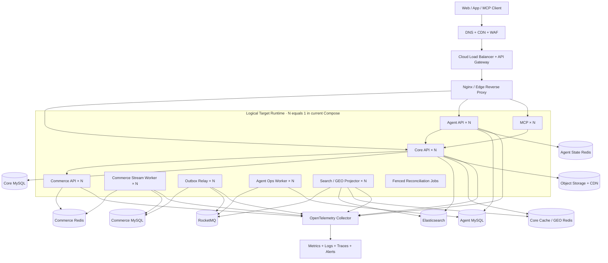
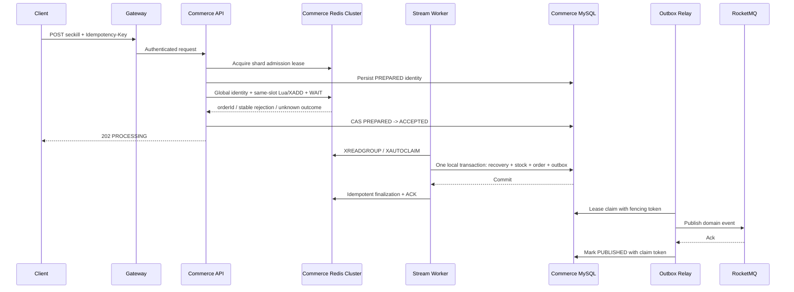
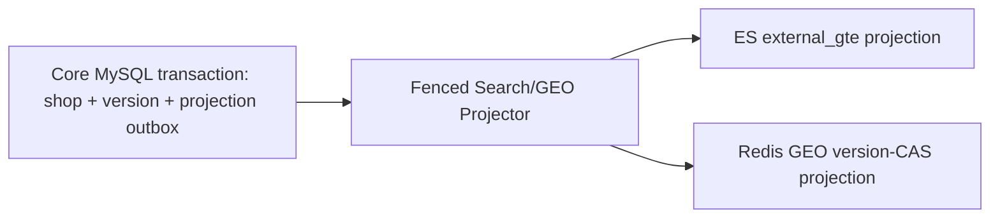

# CityCopilot 生产级高并发目标架构

状态：目标态设计与当前落地基线，尚未完成生产部署与容量验证
日期：2026-08-04
适用范围：Core、Commerce、Agent、MCP、Search/GEO 投影及其生产运行平台

## 1. 设计结论

CityCopilot 的生产形态固定为四个领域服务，不再按技术层继续拆服务：

- Core：身份、店铺、社区、工具执行与兼容 API 的权威入口；
- Commerce：优惠券、库存、Reservation、订单、补偿和交易事件的唯一写入方；
- Agent：对话执行、显式偏好、待确认动作、Ops Case/Plan/Evidence 的唯一写入方；
- MCP：无状态协议适配层，只调用 Core，不持有业务数据。

同一服务可以按运行职责拆成多个独立进程或容器，但不因此形成新的业务微服务。API、Stream Worker、Outbox Relay、Ops Worker、Search/GEO Projector 可以使用同一服务制品的不同 role/profile 独立启动；当前 `compose.yaml` 仍以 Core、Commerce、Agent、MCP 四个固定服务实例为主，不提供自动扩缩容。

系统采用以下一致性边界：

- MySQL 是唯一业务事实源；
- Redis 负责原子准入、短期状态、缓存和 GEO 投影，不作为已完成业务事实的唯一副本；
- Elasticsearch 是可重建、可降级的全文与地理搜索投影；
- Redis Stream 只承载 Commerce 内部订单命令；
- RocketMQ 只承载跨服务领域事件；
- 跨服务不使用 XA/Seata，统一采用本地事务、Transactional Outbox、至少一次投递、Consumer Inbox、聚合版本和幂等补偿。

当前仓库的部署基线是单机 Docker Compose，应用与数据服务位于同一主机的隔离网络中，默认业务端口只绑定本机地址。若用于真实生产，公网入口应由仓库外的 CDN/WAF/API Gateway/反向代理承接，MySQL、Redis、RocketMQ、Elasticsearch 优先迁移到独立主机或托管高可用服务。单机部署不具备主机级高可用，仓库也不提供集群编排层。

### 1.1 2026-08-04 当前落地基线

- 已提供生产 profile、Dockerfile、Docker Compose profile、健康检查、资源上限、重启策略和优雅停机。当前 Compose 启动 Core、Commerce、Agent、MCP 各一个固定实例；部分 Worker/Reconciliation/Outbox/Projector role 仍与所属服务同进程运行，独立 role/profile 需要显式启动，不能描述成已经自动扩缩容。
- Commerce 已改为 Redis Cluster 同槽 Lua 准入、分片 Stream、MySQL Recovery/Outbox、可过期 claim/fencing、毒消息持久化和无限可重试 Outbox；单券当前仍固定到一个逻辑 hash-tag shard，不包含下文的多 bucket/escrow 扩展。
- Search/GEO 已使用同事务 MySQL Outbox、共享 writer lease/fencing、版本化 ES/GEO 写入、封闭水位追平和 cutover barrier；当前是 Projector 直接消费 MySQL Outbox，不经过 RocketMQ。
- Agent 生产角色禁用 JVM 状态回退，目录 readiness 能区分短暂刷新失败与过期缓存；显式偏好仍只是搜索/排序提示，不是完整推荐系统。
- 尚未完成的代码边界包括 Shop 删除 tombstone、独立 `shop_type` 变更传播，以及超热点券多 bucket 库存 escrow。Search/GEO 有界重建与一次性旧代际回收的实现及验证边界见 [ADR-0010](../adr/0010-versioned-shop-search-geo-projections.md)。
- 所有吞吐、可用性、跨 AZ 接管、Redis 复制确认、MQ/ES/MySQL 托管服务握手和 RPO/RTO 数值仍需真实环境验证；本节不把静态配置或单元测试写成生产证明。

## 2. 设计约束与质量目标

### 2.1 设计约束

- 高并发主要集中在秒杀准入、店铺搜索、附近店铺和 Agent SSE；
- 秒杀优先保证不超卖、不重复和可恢复，峰值时允许异步完成；
- 查询允许短暂陈旧，订单、库存、权限、可下单状态必须由所属服务权威校验；
- Core、Commerce、Agent 禁止跨库查询、跨库外键或直接写入对方数据库；
- 应用实例必须无状态；任何必须跨实例共享的文件进入对象存储；
- 生产 profile 禁止回退到 JVM 内存状态、旧 writer 或本地文件；
- 当前没有可信生产峰值数据，本文的 QPS 是容量参数而不是已实现指标，不得作为简历实测值。

### 2.2 SLO 与数据目标

| 能力 | 生产目标 |
|---|---|
| Core/Commerce 可用性 | 月度不低于 99.95% |
| Agent/MCP 可用性 | 月度不低于 99.9%；外部模型故障单独核算 |
| 普通业务 API | 声明容量内 p95 < 200 ms，p99 < 500 ms |
| 秒杀准入 API | 声明容量内 p95 < 100 ms，成功请求返回 202 |
| 店铺搜索 | p95 < 300 ms；ES 故障时自动降级 |
| 跨服务事件 | 端到端 p99 < 30 s，oldest unpublished age < 60 s |
| Search/GEO 投影 | 正常状态 p99 lag < 10 s，无永久丢更新 |
| Commerce 数据不变量 | 超卖 0、重复有效订单 0、已提交 Outbox 永久丢失 0 |
| Commerce 同地域故障 | 已提交订单 RPO 0，自动故障转移 RTO <= 60 s |
| 区域灾难 | RPO <= 5 min，RTO <= 30 min |

LLM 首 Token 和完整响应延迟单独建立 SLO，不能用外部 Provider 延迟掩盖平台自身延迟。

### 2.3 容量计算

集群规模基于压测得到的安全吞吐计算，不用经验数字硬编码：

```text
applicationInstances
= ceil(peakRps / (verifiedInstanceRps * 0.60))
+ 预期实例或主机故障后的容量余量

redisPrimaryShards
= ceil(peakAdmissionQps / (verifiedShardQps * 0.50))

streamRecoveryTime
= backlog / (consumeRate - arrivalRate)

dbPoolPerInstance
= floor((maxConnections - operationalReserve) / maxApplicationInstances)
```

- 容量验收必须覆盖预计峰值的 2 倍持续流量和正常流量的 10 倍短时突发；
- 当前单机 Compose 没有主机故障余量；只有部署到多台独立主机后，才可以验收剩余实例承载声明峰值；
- Worker 持续消费能力必须高于持续准入速率，最大 inflight、Stream 内存和允许恢复时间形成硬限额；
- MQ 消息保留时间必须长于最大故障窗口、人工响应时间和重放窗口之和。

## 3. 目标拓扑

下图描述仓库外可扩展的逻辑目标，不代表当前实例数。当前 `compose.yaml` 中 `N=1`，三个 MySQL、Redis、RocketMQ 和 Elasticsearch 都是单机容器；图中的多实例与高可用数据层只有迁移到多台主机或托管服务后才成立。



## 4. 生产运行单元

| 运行单元 | 当前单机 Compose 基线 | 手动扩容依据 | 责任 |
|---|---|---|---|
| Core API | 1 个 Core 容器 | RPS、CPU、p95、连接池等待 | 权威业务 API、工具执行、查询编排 |
| Commerce API | 1 个 Commerce 容器 | admission RPS、CPU、Redis 延迟 | 同步准入和订单状态 API |
| Commerce Stream Worker | 随 Commerce 进程运行 | Stream lag、PEL、oldest message age | Redis 命令落库、恢复、补偿和 ACK |
| Outbox Relay | 随 Commerce 进程运行 | ready 数、oldest ready age | Claim、发布 MQ、无限退避重试与告警 |
| Agent API | 1 个 Agent 容器 | SSE 连接、首 Token、Provider 并发 | 对话、偏好解析、执行编排和确认 |
| Agent Ops Worker | 随 Agent 进程运行 | MQ lag、Case backlog、LLM 配额 | Ops Case/Plan/Evidence 异步闭环 |
| MCP | 1 个 MCP 容器 | RPS、活跃连接 | MCP/SSE/HTTP 到 Core 的协议适配 |
| Search/GEO Projector | 随 Core 进程运行 | event lag、bulk queue、projection lag | 版本化更新 ES、GEO 和缓存 |
| Commerce Reconciliation | 随 Commerce 进程运行且保持单执行者 | discrepancy、repair backlog | 当前尚无分布式 scheduler lease，不能并行运行 |
| Search/GEO Reconciliation | 随 Core 进程运行、由 lease 选主 | projection lag、repair backlog | 带 MySQL lease/fencing 的对账、重建和修复 |

所有进程或容器必须配置：

- 明确的 CPU/内存上限，并根据统一压测结果手动确定实例数；
- startup、liveness、readiness 三类独立健康检查；
- `server.shutdown=graceful`、先摘流后停止和足够的终止宽限时间；
- Worker 停止时先停止领取，再提交、ACK 或安全释放 lease；
- 数据库连接池按最大并发实例数统一预算，避免扩容把 MySQL 连接打满；
- 多主机部署时由仓库外的运行平台负责实例分散、故障转移和流量切换，当前 Compose 不提供这些能力。

定时任务不得依赖每个实例都执行一次的 `@Scheduled`。Search/GEO 已使用数据库 lease/fencing；Commerce Reconciliation 在补齐 scheduler lease 前只能保持单执行者，不能水平扩容。可分片任务按稳定 shard 分配。

## 5. 服务边界与数据所有权

| 数据域 | 唯一事实源 | 派生数据 |
|---|---|---|
| 用户、店铺、分类、坐标、社区、工具审计 | Core MySQL | Redis 缓存/GEO、ES 店铺文档 |
| 优惠券、库存 bucket、Reservation、订单、Recovery、Outbox、DLQ | Commerce MySQL | Commerce Redis 准入状态和 Stream |
| 显式偏好、待确认动作、Ops Case/Plan/Evidence | Agent MySQL | Agent Redis 短期执行状态 |
| 图片和附件 | 对象存储 | CDN 缓存 |
| 店铺全文、地理过滤和偏好软排序 | Elasticsearch | 可删除、可从 Core MySQL 重建 |
| 跨服务事件 | 各生产者 MySQL Outbox | RocketMQ 只是传输和保留介质 |

每个可发布聚合必须有单调递增的 `aggregate_version`；删除必须产生 tombstone 事件。服务之间只能通过版本化 HTTP API 或领域事件共享数据。

## 6. 入口、同步通信与背压

### 6.1 入口

- 前端静态资源和公开图片由 CDN 提供；上传使用对象存储预签名 URL；
- API Gateway 负责 TLS、WAF、JWT 校验、用户/IP/设备/路由级限流、请求大小、访问审计和防重放；
- `/api/agent/**` 路由到 Agent，`/api/**` 路由到 Core；Commerce 仅允许 Compose 私有网络或受控内网访问；MCP 使用独立受限入口；
- 后端服务、数据库、Redis、MQ 和 ES 不暴露公网端口。

### 6.2 服务通信

- 单机环境使用 Docker Compose 服务名和显式环境变量端点；未来多主机部署通过外部负载均衡或私有 DNS 提供稳定地址，不引入 Nacos/Eureka；
- Core 到 Commerce、Commerce 回查 Core、Agent/MCP 到 Core 使用版本化 HTTP；截止时间、容量限制和取消边界见[跨服务请求预算](request-budgets.md)；
- 只有幂等读或携带稳定 Idempotency-Key 的命令允许自动重试；
- 写命令失败时不得回退到旧本地 writer；
- 熔断只阻止故障扩散，不能伪造成功；429/503 必须带稳定错误码和 Retry-After；
- HTTP、RocketMQ、Agent Tool 调用统一传播 `traceparent`、requestId、correlationId 和 actor。

## 7. Commerce 高并发交易设计

### 7.1 对外契约

```http
POST /commerce/v1/seckill/{voucherId}
Authorization: Bearer <token>
Idempotency-Key: <required stable value>
```

新准入成功返回：

```http
202 Accepted
Location: /commerce/v1/orders/{orderId}
```

```json
{
  "orderId": "<globally-unique-id>",
  "state": "processing",
  "code": "COMMERCE_ORDER_ACCEPTED",
  "idempotencyKey": "<same-request-key>"
}
```

安全幂等重放返回 `200 OK`、`code=IDEMPOTENT_REPLAY` 和相同 orderId。稳定错误码包括 `VOUCHER_NOT_AVAILABLE`、`SECKILL_STOCK_NOT_ENOUGH`、`SECKILL_DUPLICATE_ORDER`、`COMMERCE_IDEMPOTENCY_CONFLICT`、`COMMERCE_ADMISSION_OUTCOME_UNKNOWN` 与路由/容量类 503。Lua 写入后若复制确认或响应失败，服务返回结果未知和 `Retry-After: 1`；客户端只能使用同一幂等键重试。

### 7.2 Redis 原子准入

秒杀的库存/活动判断不查询 MySQL 事实表、不持有热点库存行锁、不发布 RocketMQ，也不调用其他业务服务。每次请求会写 MySQL admission ledger 的 `PREPARED`/`ACCEPTED` 状态作为接受承诺边界；订单 ID 来自预留在 JVM 的持久 MySQL hi/lo 号段，只有本地号段耗尽时才执行一次短事务预留下一段：



Lua 必须原子完成：

- 校验活动 generation、时间窗、fence 和状态；
- 校验 `Idempotency-Key + requestFingerprint`；
- 校验一人一券；
- 扣减 bucket 库存；
- 登记 buyer、幂等结果和 inflight；
- `XADD` 到该物理 shard 的订单 Stream。

跨券全局 `Idempotency-Key` 先通过另一个 Redis 单 key `SET NX` 注册
`user + key -> orderId + voucher + fingerprint`，再执行券所在 slot 的 Lua。
两步跨 slot 不是 Redis 原子事务；注册成功后崩溃可以用同一 orderId 续跑，
MySQL 的 `UNIQUE(user_id,idempotency_key)` 仍是最终约束。Redis 故障转移、
routing generation 迁移和跨地域恢复必须专门验证这一窗口。

Redis 命令不可用或活动元数据/库存状态不完整时，准入 fail closed，不能退化成
MySQL 行锁下单。生产路径对 admission lease、全局幂等和券 Lua 执行同主连接
`WAIT`，并在写前/确认后核对当前 master 的全部已配置副本；admission backlog、
最老年龄、人工修复行、Stream/inflight 与路由迁移均设有 fail-closed 水位。
这些机制尚未在真实 Redis Cluster 上取得目标流量下的 p99/吞吐和故障注入证据，
因此不能把设计值当作已验证容量。

### 7.3 Redis Cluster key 与分片

活动创建时固定 routing generation 和 bucketCount：

```text
bucket = hash(userId, voucherId, generation) % bucketCount
physicalShard = routingTable[generation][bucket]
hashTag = {commerce:<physicalShard>}
```

同一次 Lua 的所有 key 必须位于同一个 hash slot：

```text
cc:{commerce:07}:voucher:100:g3:bucket:12:meta
cc:{commerce:07}:voucher:100:g3:bucket:12:stock
cc:{commerce:07}:voucher:100:g3:bucket:12:buyers
cc:{commerce:07}:voucher:100:g3:bucket:12:inflight
cc:{commerce:07}:voucher:100:g3:bucket:12:idem:<userId>:<keyHash>
cc:{commerce:07}:orders
```

- 普通活动只使用一个库存 bucket；单主分片压测容量不足的超热点活动才启用多个 bucket；
- `sum(bucket.allocatedStock) = campaign.totalStock`；
- bucket 间库存迁移使用持久化 transfer token 和 escrow，允许暂时少卖，不允许先增加目标库存造成超卖；
- 活动运行期间不改变 generation 或 bucket 路由；
- Stream 按物理 shard 建立，使用安全 ACK watermark 的 `XTRIM MINID`，不能删除仍在 PEL 中的记录。

### 7.4 Stream Worker

- Consumer Group 使用版本化固定名称；consumer identity 必须包含稳定实例标识和进程启动 UUID；
- 新 Group 等价于 `XGROUP CREATE ... 0 MKSTREAM`，只能忽略明确的 BUSYGROUP；
- 正常消费使用 `XREADGROUP >`，当前故障恢复使用带排他游标的
  `XPENDING + XCLAIM` 分页遍历完整 PEL；
- MySQL Recovery 的 `claim_token + claim_version + claimed_until` 是业务所有权 fencing；Redis consumer ownership 只负责传输；
- ACK 只能发生在 MySQL 已形成持久终态，并且 Redis finalization/compensation 已幂等完成之后；
- 毒消息先形成可重放的 Recovery 终态并把原始 payload、Stream ID、错误原因
  写入持久化 DLQ；已落单只 finalization，未落单且身份可证明才幂等补偿，
  随后用同槽 Lua `XACK + XDEL`。

### 7.5 MySQL 事务

订单创建事务只包含本地数据库操作：

1. 插入或核验 Recovery 记录与 payload hash；
2. 插入或核验幂等记录；
3. 对对应 stock bucket 执行 `stock > 0` 的条件扣减；
4. 插入或核验订单；
5. 将 Recovery 更新为 `ORDER_CREATED`；
6. 插入唯一的 `OrderCreated` Outbox；
7. 提交事务。

事务内禁止 Redis、RocketMQ、HTTP 和对象存储等网络调用。关键约束：

```text
UNIQUE commerce_order(user_id, voucher_id)
UNIQUE commerce_order(user_id, idempotency_key)
PRIMARY KEY commerce_order_recovery(source_id)
UNIQUE commerce_outbox_event(
  aggregate_type, aggregate_id, event_type, aggregate_version
)
```

`source_id` 编码 routing generation、逻辑 shard 数、shard 与 Stream record ID，
避免不同 Stream 中相同 record ID 冲突。

相同幂等键和相同 fingerprint 是安全重放；相同幂等键但不同 fingerprint 是永久冲突；一人一券冲突关联已有订单并补偿当前 admission。

### 7.6 Outbox 与跨服务事件

Outbox Relay：

- 当前实现先读取候选 ID，再用带状态/过期条件的原子 `UPDATE` 逐条 claim；
  多 Relay 通过 `claim_token + fencing_token` 竞争，不持有跨网络数据库锁；
- claim 提交后再调用 MQ，不能持有数据库锁执行网络请求；
- `READY/FAILED` 和租约过期的 `CLAIMED` 都可重新认领；
- 所有更新携带 `claim_token + fencing_token` 并检查影响行数；
- 发送成功但未标记 PUBLISHED 时允许重发；
- 同一聚合只认领最小未发布 aggregateVersion；
- 失败使用有上限的指数退避但不进入不可恢复终态；历史 `DEAD` 也会重新认领，
  由 oldest-age/attempts 告警推动修复。

事件信封固定包含：

```text
eventId, eventType, schemaVersion,
aggregateType, aggregateId, aggregateVersion,
occurredAt, producer,
correlationId, causationId, traceparent,
payload
```

每个消费者在自己的 MySQL 中维护 Inbox。Inbox 插入、消费者本地业务变化和 projection version 更新必须在同一事务；同 eventId/同 hash 直接 ACK，同 eventId/不同 hash 进入 quarantine，旧 aggregateVersion 幂等忽略。

### 7.7 交易不变量

```text
campaign.totalStock = sum(bucket.allocatedStock)

bucket.allocatedStock
= redis.remaining
+ redis.inflight
+ mysql.consumingOrders
+ unresolvedRecovery
```

持续满足：

- 任意 Redis bucket 库存不小于 0；
- consumingOrders 不超过 campaign.totalStock；
- 同一用户对同一券最多一个有效订单；
- 同一幂等键和 fingerprint 永远返回同一 orderId；
- 一个 Stream command 最多产生一次 MySQL 业务效果；
- 一个 aggregateVersion 最多一条 Outbox；
- MQ 可以重复投递，但每个 consumer group 最多产生一次本地业务效果；
- 补偿、库存转移、finalization 和修复都使用持久化 operation token，重复执行结果相同。

## 8. Shop Search、GEO 与个性化投影

### 8.1 店铺变更链路

Core 修改店铺的同一 MySQL 事务同时递增 `projection_version` 并写入内部 `shop_projection_outbox`：



当前 Outbox 保存 eventId、shopId、aggregateVersion 和操作类型，Projector 再从权威表读取最新快照。删除 tombstone 与跨服务 RocketMQ Relay/Inbox 是后续扩展，尚未实现。投影规则固定为：

```text
incomingVersion > storedVersion  -> apply
incomingVersion <= storedVersion -> idempotent ignore
```

### 8.2 Elasticsearch

- 集群使用读 alias，例如 `citycopilot-shop-read`；物理索引使用 schemaVersion 和 generation 命名；
- 增量写采用 external version 或脚本比较，旧版本不能覆盖新文档；
- Projector 使用 Bulk API 和正常 refresh interval，不在业务事务 afterCommit 中同步 `refresh=wait_for`；
- 查询文档包含展示所需字段，避免每次搜索都批量回表；但下单、权限、库存和可用性必须再次调用权威服务校验；
- preferredCategory、价格偏好等只做 soft boost，不能硬过滤其他候选；响应记录采用了哪些显式偏好；
- ES 异常时 Core 回退 MySQL/Redis GEO，并记录 fallback rate 和 projection lag。

全量重建协议：

1. 获取带 fencing token 的重建租约；
2. 创建新 generation 并记录事件/数据库高水位 W0；
3. 按扫描开始时的店铺主键上界分页读取，搜索复用 generation Bulk 写入、GEO 按页批量写入，每页之间续租；当前代码与统一验证边界见 [ADR-0010](../adr/0010-versioned-shop-search-geo-projections.md)；
4. 当前 writer lease 让增量 Projector 与 rebuild 互斥，rebuild 用 Outbox 水位追平 building generation；
5. building generation 追平当前高水位后，校验文档数、最大版本、抽样 hash、DLQ 和失败数；
6. 使用一次原子 alias update 切换读 alias；
7. 保留活跃代际和最近退役代际；更早代际在保留期结束且读者实际排空后，通过 [ADR-0010 的一次性维护入口](../adr/0010-versioned-shop-search-geo-projections.md#旧代际受控回收)有界回收。

### 8.3 Redis GEO

GEO 按城市和 generation 建模：

```text
geo:{hangzhou}:active                 -> g-102
geo:{hangzhou}:g-102:all              -> GEOSET
geo:{hangzhou}:g-102:type:1           -> GEOSET
geo:{hangzhou}:g-102:version          -> HASH(shopId, version)
```

- 新 generation 构建期间不删除 active；
- 当前 writer lease 让增量写与 rebuild 互斥，并由水位尾追补齐 building generation；
- 构建追平高水位后，Redis Lua 校验 fencing token 并原子切换 active；
- 查询发现 generation 在请求期间变化时最多重试一次；
- 热点城市超过单槽容量时按稳定地理 tile 拆分；复杂地理过滤由 ES geo_point 承担。

### 8.4 缓存

- L1 Caffeine 只使用 1–5 秒短 TTL；L2 Redis TTL 加随机抖动；
- 空值短缓存，热点 miss 使用 single-flight/request coalescing；
- 缓存值携带 aggregateVersion，回源写入使用 CAS，旧值不能覆盖新投影；
- 主动失效由事务提交后的 Outbox 事件驱动，禁止在事务提交前删除缓存；
- 分类等低频数据同样有 TTL 和事件失效，不允许永久缓存；
- 监控命中率、回源 QPS、热点 key、大 key、淘汰率和内存碎片率。

## 9. Agent 生产运行设计

- 目标态允许 Agent API 和 Ops Worker 使用同一制品独立启动、独立线程池并手动扩容；当前 Compose 中 Ops Worker 仍随 Agent 进程运行；
- 显式偏好、待确认动作、Case/Plan/Evidence 持久化到 Agent MySQL；生产 profile 缺少 Redis/MySQL 时 readiness 失败，不回退 JVM 内存；
- SSE 事件携带可恢复 cursor，客户端断线后可重连；实例摘流后不再接收新会话；
- 对每个用户、租户、模型 Provider 设置并发配额、超时、bulkhead 和预算；
- Provider 限流或故障返回稳定的可重试/不可重试错误，不无限重试；
- 写工具必须携带稳定 Idempotency-Key，敏感操作继续经过 confirmation 和权限校验；
- 显式用户偏好只作为搜索/排序提示。偏好来源、更新时间、否定和修正可审计，不能把它描述成完整推荐算法；
- Prompt、Trace 和日志执行字段级脱敏，默认不记录 Token、手机号、完整私密对话或敏感工具输出。

## 10. 数据基础设施

本节全部是仓库外正式生产目标。当前 Compose 使用三个单节点 MySQL 容器、一个共享 Redis 实例、单 Broker RocketMQ 和单节点 Elasticsearch，不具备数据层高可用，也不能用来证明下述跨主机故障转移能力。

### 10.1 MySQL

Core、Commerce、Agent 使用独立数据库、独立账号和独立迁移历史；正式生产目标为 Commerce 使用独立物理 HA 集群，并具备单写、多 AZ 同步/半同步副本、自动故障转移、连接代理、binlog、PITR、每日全量和跨地域备份。

- 写、事务、写后读、Outbox Relay 和投影高水位读取走 writer；
- 只有允许陈旧的列表、分析和审计查询走 reader；
- 连接总量保持在预算的 70% 以下；
- DDL 使用 Flyway expand-contract，由独立 migration Job 执行；操作与已有库接管见 [数据库迁移运行手册](../database-migrations.md)；
- 不默认分库分表。Redis/Stream 已吸收突发，MySQL 持续写容量未越界前，索引、归档、分区和读副本更简单可靠；
- 若未来物理分片，order、recovery、stock bucket 和 outbox 必须按同一稳定路由键共置，一个业务事务不得跨库。

### 10.2 Redis

正式生产目标把 Redis 分为三个独立故障域：

1. Commerce Redis Cluster：3 主 3 从、跨 AZ、AOF、noeviction、最小副本写确认；只承载准入、inflight、幂等镜像和 Stream；
2. Core Cache/GEO Redis Cluster：跨 AZ，允许淘汰，设置 namespace 容量配额；
3. Agent State Redis：独立高可用实例，保存会话、待确认动作和短期执行状态。

Redis Cluster 只使用 DB 0，依赖 namespace 和 ACL 隔离。Commerce Redis 故障转移仍可能出现未复制写，因此 MySQL Recovery、唯一约束、对账和幂等补偿必须长期存在。

### 10.3 RocketMQ

- 使用多个 NameServer、三节点 Controller quorum、至少两个 Broker Group 和跨 AZ 副本；
- Proxy 独立部署和负载均衡；Topic 显式配置队列、保留、重试和 DLQ；
- eventId 作为 message key，aggregateId 作为顺序/分区键；
- 不依赖全局 FIFO，消费者必须用 aggregateVersion 拒绝旧事件；
- MQ 不可用时业务事务继续提交，Outbox 积压并触发 oldest-age 告警。

### 10.4 Elasticsearch

- 托管三 AZ 集群，至少三个 master-eligible 节点，数据节点按压测容量配置；
- 每个 primary shard 至少一个 replica，TLS、认证、最小权限和私网访问；
- 目标 shard 大小、shard 数量和磁盘水位根据真实数据测算，禁止过度分片；
- 对象存储快照、受控旧 generation 清理和完整重建演练是上线条件；
- ES 不参与 Core liveness；readiness 只在无法提供任何安全降级时失败。

### 10.5 对象存储

- 图片和附件使用私有 bucket、预签名直传、checksum、安全扫描、版本控制和生命周期；
- Core MySQL 只保存 objectKey、checksum、size、version、owner 和状态；
- 上传状态为 `PENDING -> VERIFIED -> ACTIVE`；失败和孤儿对象异步清理；
- CDN 只分发允许公开或经过签名授权的对象。

## 11. 安全设计

- 普通配置使用版本化 Compose 文件和环境变量模板；密钥通过 Docker secrets 或外部 Secret Manager 注入，不进入仓库；
- 生产禁止根目录 `.env`、默认密码和长期共享 service token；
- 每个服务使用独立 DB 账号、Redis ACL、MQ principal 和短期服务身份；
- 服务间和数据层启用 TLS；敏感内部 API 使用 mTLS 或短期服务身份；
- 使用隔离的 Docker 网络、最小端口绑定、主机防火墙和数据服务 ACL，只开放明确服务调用和 Agent 到白名单 Provider 的出口；
- 容器使用 non-root、read-only root filesystem、seccomp 和最小 capabilities；
- 权限、幂等冲突、修复、DLQ 重放、库存转移和人工审批写不可变审计；
- 运维修复 API 使用真实 RBAC/OAuth scope，不信任布尔请求头。

## 12. 可观测性与告警

OpenTelemetry 覆盖边缘反向代理、HTTP、MySQL、Redis、RocketMQ、Elasticsearch、Agent Tool 和 LLM 调用；日志、指标、Trace 通过 Collector 统一导出。

必须监控：

- HTTP RPS、4xx/5xx、p50/p95/p99、active requests；
- JVM/容器 CPU、内存、GC、线程池、连接池 pending 和 timeout；
- Redis latency、memory、replication、hot key、Stream lag、PEL 和 oldest message；
- MySQL QPS、锁等待、死锁、慢 SQL、replica lag、连接饱和；
- Outbox READY/CLAIMED/FAILED/DEAD、oldest age 和 publish latency；
- RocketMQ produce/consume latency、lag、retry 和 DLQ；
- 秒杀 accepted、created、compensated、repair-required、库存 discrepancy；
- ES query latency、rejection、projection lag、fallback rate、rebuild generation；
- Agent Tool 成功率、LLM 首 Token/总耗时、Provider 限流、Case backlog；
- 对象上传失败、安全扫描失败和孤儿对象。

日志固定携带 service、version、requestId、traceId、correlationId 和错误码。Metrics 标签禁止使用 userId、orderId 等高基数字段。告警必须同时覆盖错误率、延迟、饱和度、积压、业务不变量和恢复失败。

## 13. CI/CD 与制品

- PR 门禁包含单元测试、Testcontainers 集成测试、契约兼容、Agent Eval、完整 Compose smoke、SAST、依赖/Secret/镜像扫描；
- 按 Git SHA build once，生成 SBOM、签名镜像并推送 Registry；所有环境部署同一 digest；
- 数据库迁移由独立的一次性任务运行，遵守 expand-contract，应用发布不能执行 `spring.sql.init.mode=always`；
- CI 管理并校验版本化 Compose 与数据服务配置；当前单机发布通过重建固定容器完成，回滚到上一镜像 digest。滚动或金丝雀发布需要仓库外的多主机运行平台，不能写成当前已落地能力；
- 事件 schema 采用向后兼容规则；删除字段、改变语义或重用 eventType 必须新建版本；
- Search 使用 shadow 对比作为长期回归能力，但生产读 alias 的切换仍受 projection 健康门禁控制。

## 14. 故障语义

| 故障 | 固定行为 |
|---|---|
| Commerce Redis 不可用 | 关闭新准入并返回 503，不回退 MySQL 抢锁 |
| MySQL 暂时不可用 | Stream 保留命令；达到 backlog/inflight 上限后关闭准入 |
| Worker 在 DB 提交前退出 | 当前由重启后的 Worker 根据 PEL 与 Recovery lease 恢复；多实例目标态才由其他 Worker 接管 |
| DB 已提交但 Stream ACK 失败 | 重放读取终态，只执行幂等 finalization 和 ACK |
| RocketMQ 不可用 | 业务事务不回滚；Outbox 积压、告警和后续重发 |
| MQ 已发送但 Outbox 未标记 | Relay 重发；消费者 Inbox 消除重复副作用 |
| 毒消息或不兼容 schema | 持久化 quarantine/DLQ、告警并停止无限重试 |
| ES 不可用 | Core 降级 MySQL/Redis GEO，业务写不受影响 |
| ES/GEO 重建者退出 | lease 到期后接管，不切换未追平的新 generation |
| LLM Provider 不可用 | Agent 返回稳定失败或允许恢复的状态，不绕过确认执行写工具 |
| 单应用实例退出 | 进程或容器重启后由 lease/PEL/Inbox 接管未完成任务；单机主机故障会中断全部服务，只能通过备份恢复 |

## 15. 端到端生产闭环

这不是实施顺序，而是架构必须一次贯通的最小生产闭环：

```text
Authenticated request
-> Gateway rate limit and trace context
-> Commerce same-slot Lua admission
-> Redis Stream durable command
-> Worker local MySQL transaction
-> order + recovery + outbox atomic commit
-> Redis finalization and ACK
-> Outbox Relay lease claim
-> RocketMQ at-least-once event
-> Consumer Inbox + local effect
-> query returns stable order status
-> metrics, trace, audit and alert cover the whole path
```

店铺闭环为：

```text
Core shop transaction + version + outbox
-> fenced MySQL Outbox projector
-> versioned ES/GEO projections
-> high-water catch-up and atomic generation switch
-> search applies explicit preference as soft boost
-> authoritative command revalidates Core/Commerce state
```

## 16. 生产验收门槛

- 预计峰值 2 倍持续压测和 10 倍短突发下仍满足 SLO；
- 随机终止 API、Worker 进程或容器，验证重启后任务自动接管；主机故障通过备份恢复演练验收，当前单机环境不宣称节点或可用区容灾；
- Redis 主节点、MySQL writer、RocketMQ Broker、ES data node 故障转移不破坏业务不变量；
- 覆盖“DB 提交前退出”“DB 提交后 ACK 前退出”“MQ 发送后 PUBLISHED 前退出”“投影快照后 alias 切换前更新”等故障窗口；
- 多 Core 并发重建 ES/GEO 时只有合法 fencing owner 可以切换 generation；
- 超卖、重复业务效果和已提交事件永久丢失均为 0；
- Outbox、Stream、MQ 和投影积压能在声明恢复窗口内归零；
- 从空白环境完成 MySQL PITR、Redis 恢复/重建、ES 重建和对象恢复，并测得真实 RPO/RTO；
- 滚动发布、迁移和回滚无不可接受错误峰值、消息丢失或 schema 不兼容；
- 不存在 Critical CVE、明文生产密钥或公网暴露的数据服务。

只有上述门槛在多实例环境中通过，才能把该架构称为“生产级高并发分布式系统”；静态设计、单元测试或单机 Compose 运行不构成生产验证。

## 17. 明确不采用

- 不引入 Nacos/Eureka：单机使用 Compose 服务名和显式端点，未来多主机可接入外部负载均衡或私有 DNS；
- 不引入 Seata/XA：使用本地事务、Outbox/Inbox、幂等和补偿；
- 不再引入 Kafka：Redis Stream 与 RocketMQ 已有明确且不重叠的职责；
- 不把 Search 拆成新的业务微服务：它仍是 Core 的可降级读模型和独立运行角色；
- 不采用全量 Event Sourcing/CQRS：只对确有投影需求的路径使用事件读模型；
- 不默认引入 Service Mesh：反向代理、TLS、服务凭据、Docker 网络、主机防火墙和数据服务 ACL 满足当前治理范围；
- 不建设双地域 Active-Active：订单幂等、库存分配和跨地域一致性成本高于当前收益；
- 正式生产不把 MySQL、Elasticsearch、Redis 和 RocketMQ 与应用进程长期共置；有托管服务时优先降低运维风险；
- 不用 Redisson 分布式锁串行化 Commerce 热路径；锁不能替代事务幂等、ACK 恢复和消息重放。

## 18. 关联决策

- [ADR-0004：Core 与 Agent 服务边界](../adr/0004-core-agent-service-boundary.md)
- [ADR-0005：Redis Stream 与 RocketMQ 分层消息](../adr/0005-redis-stream-and-rocketmq-layered-messaging.md)
- [ADR-0006：Commerce 与 Place 边界及数据所有权](../adr/0006-commerce-place-service-boundaries.md)
- [ADR-0009：Commerce 高并发准入与恢复语义](../adr/0009-commerce-high-concurrency-admission.md)
- [ADR-0010：Shop Search 与 GEO 版本化投影](../adr/0010-versioned-shop-search-geo-projections.md)
